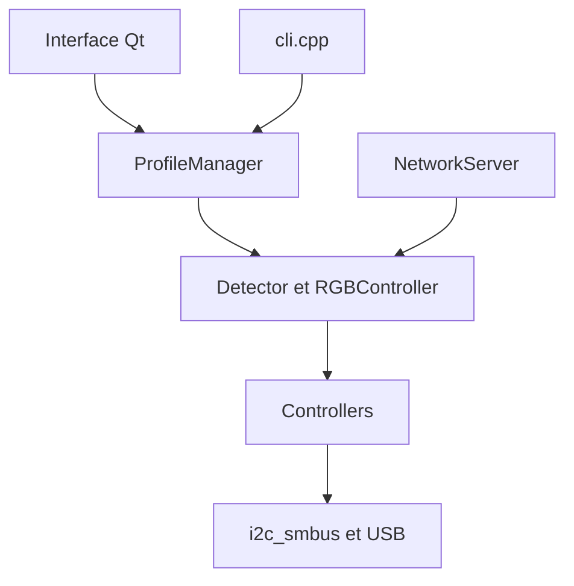

# CalcProgrammer1/OpenRGB

> Application unique pour piloter l'éclairage RGB de matériels de marques différentes, sans logiciel constructeur.

## Le problème
Chaque fabricant impose son logiciel RGB, souvent Windows seulement, parfois avec compte en ligne.

## Ce que ça fait vraiment
OpenRGB règle couleurs et effets sur un large matériel, enregistre des profils, offre une CLI et un SDK réseau pour d'autres logiciels, et peut fonctionner en serveur sans interface ou synchroniser plusieurs PC. Des contrôleurs par appareil reposent sur des protocoles rétro-conçus, via libusb, hidapi ou SMBus. Des plugins ajoutent des fonctions.

## Comment c'est branché

## Essayer
Aucune commande documentée : télécharger les binaires sur openrgb.org ou les releases, puis configurer l'accès USB et SMBus.

## Coût et pièges
Gratuit. Le README avertit que du matériel a déjà été endommagé par des protocoles mal compris. Règles udev à installer pour AppImage et Flatpak. Sous Windows, runtime Visual C++ 2019.

## Ce que ce n'est pas
Pas un outil officiel d'un constructeur. Aucune garantie contre un dommage matériel.

## Alternatives
Aucune alternative nommée dans le README comme remplaçante.

## Pour toi
Ignorer : un utilitaire d'éclairage de PC, sans lien avec ton travail data ou IA.

