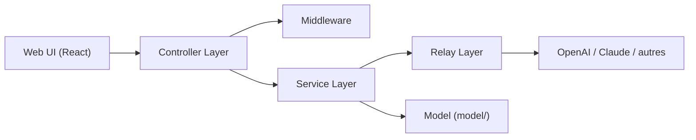

# Calcium-Ion/new-api

> Self-hosted AI gateway that unifies model APIs and manages routing, quotas and costs for teams.

## The problem
Each application configures its own providers (OpenAI, Anthropic, Gemini...) and nobody tracks who consumes what.

## What it actually does
A Go server (Gin) with a React console. It exposes the OpenAI APIs (chat, responses, embeddings, images, audio), Anthropic Messages and Gemini, converts between protocols (RelayKit) and routes across channels with priorities, weights and retries. User, group, key, quota, subscription and log management; JavaScript plugins for asynchronous tasks. SQLite, MySQL or PostgreSQL database, optional Redis.

## How it is wired


## Trying it
```bash
docker run --name new-api -d --restart unless-stopped \
  -p 127.0.0.1:3000:3000 \
  -e TZ=Asia/Shanghai \
  -v "$(pwd)/data:/data" \
  calciumion/new-api:latest
curl --fail-with-body http://localhost:3000/v1/models -H "Authorization: Bearer ${NEW_API_KEY}"
```

## Cost and gotchas
Upstream keys and providers' bills remain your responsibility. In production: HTTPS, a persistent `SESSION_SECRET`, a shared database for multiple nodes; pin the image version. The README reminds you of legal obligations if you resell access. License not recorded in the catalog.

## What it is not
Not a model provider: it relays the ones you subscribe to. Protocol conversions do not map every field.

## Alternatives
The README cites One API, the original project, and Midjourney-Proxy for Midjourney.

## For you
Adopt on a trial basis if you need to share LLM access across teams with cost tracking; check the license in the repository first.
