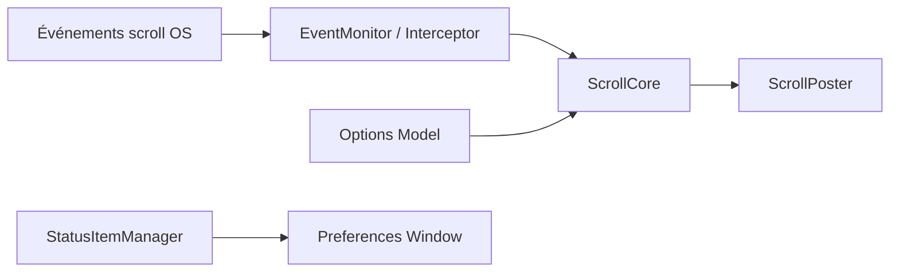

# Caldis/Mos

> macOS menu bar tool that smooths the mouse wheel and remaps its buttons.

## The problem
On macOS, a classic mouse wheel scrolls in jerks, lacking precision, unlike a trackpad.

## What it actually does
Mos intercepts scroll events, interpolates them into smooth scrolling and reinjects them. It adjusts step, gain and duration, separates the vertical and horizontal axes, offers per-application configuration and binds mouse buttons to actions, scripts or shortcuts. It also handles the buttons of Logitech devices (HID++). The README is in Chinese.

## How it is wired


## Trying it
```bash
brew install --cask mos
brew update
brew upgrade --cask mos
```

## Cost and gotchas
Free. macOS 10.13 or later; accessibility permission is mandatory to read and rewrite scrolling. License present but not identified by GitHub: verify before reuse. The README rejects large AI-generated PRs.

## What it is not
Neither cross-platform nor related to data. Translation files are not guaranteed to have been proofread.

## Alternatives
No alternative cited in the README (Smoothscroll-for-websites and Solaar are credited as inspirations).

## For you
Ignore: macOS workstation comfort with no link to data / AI work, with a license still to be clarified.
