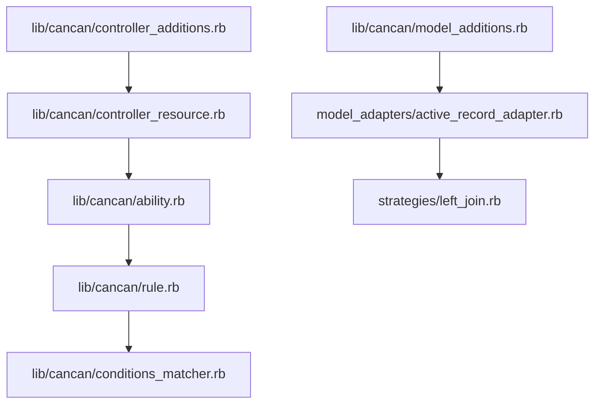

# CanCanCommunity/cancancan

> Ruby authorization library that centralizes the access rights of a Rails application in a single file.

## The problem
The rules for "who is allowed to do what" end up scattered across controllers, views and SQL queries, and become hard to maintain and test.

## What it actually does
Permissions are declared in an `Ability` class (`can :read, Post, public: true`). The `can?` and `cannot?` methods are used in views and controllers, `authorize!` raises an exception if the action is forbidden, and `load_and_authorize_resource` automatically loads and checks resources. `accessible_by` translates the rules into SQL so that only authorized objects are fetched.

## How it is wired


## Trying it
```bash
bundle install
rails g cancan:ability
bundle exec appraisal install
```
In the Gemfile: `gem 'cancancan'`.

## Cost and gotchas
Free. Requires Ruby 2.7+; Active Record 5.2 to 8.1 is tested but is not a declared dependency, so Bundler does not check its version.

## What it is not
It is not an authentication system: it assumes a current user already exists. It is only useful within the Ruby or Rails ecosystem.

## Alternatives
No alternative named in the README.

## For you
Ignore for a data / AI / MLOps profile: this is Rails authorization, outside your Python stack.
