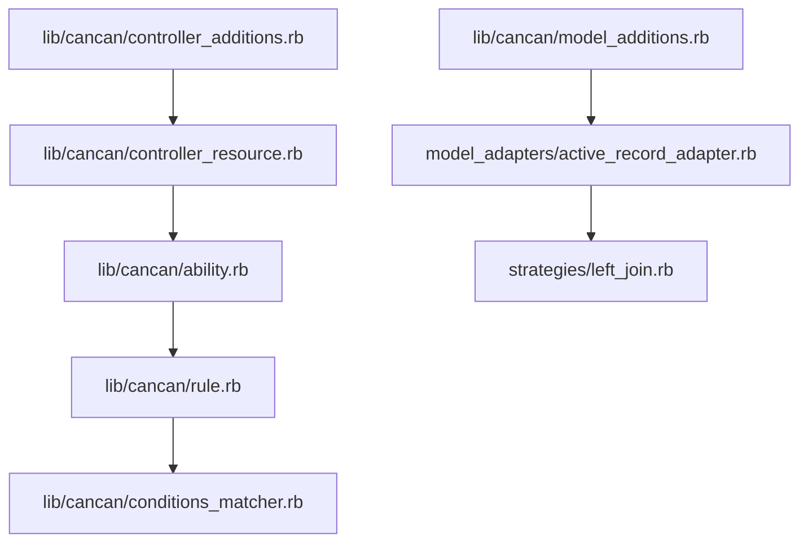

# CanCanCommunity/cancancan

> Bibliothèque Ruby d'autorisation qui centralise les droits d'accès d'une application Rails dans un seul fichier.

## Le problème
Les règles « qui a le droit de faire quoi » se dispersent entre contrôleurs, vues et requêtes SQL, et deviennent difficiles à maintenir et à tester.

## Ce que ça fait vraiment
On déclare les permissions dans une classe `Ability` (`can :read, Post, public: true`). Les méthodes `can?` et `cannot?` servent dans les vues et contrôleurs, `authorize!` lève une exception si l'action est interdite, et `load_and_authorize_resource` charge et contrôle automatiquement les ressources. `accessible_by` traduit les règles en SQL pour ne récupérer que les objets autorisés.

## Comment c'est branché


## Essayer
```bash
bundle install
rails g cancan:ability
bundle exec appraisal install
```
Dans le Gemfile : `gem 'cancancan'`.

## Coût et pièges
Gratuit. Exige Ruby 2.7+ ; Active Record 5.2 à 8.1 est testé mais n'est pas une dépendance déclarée, donc Bundler ne vérifie pas sa version.

## Ce que ce n'est pas
Ce n'est pas un système d'authentification : il suppose qu'un utilisateur courant existe déjà. Il n'est utile que dans l'écosystème Ruby ou Rails.

## Alternatives
Aucune alternative nommée dans le README.

## Pour toi
À ignorer pour un profil data / IA / MLOps : c'est de l'autorisation Rails, hors de ta pile Python.

