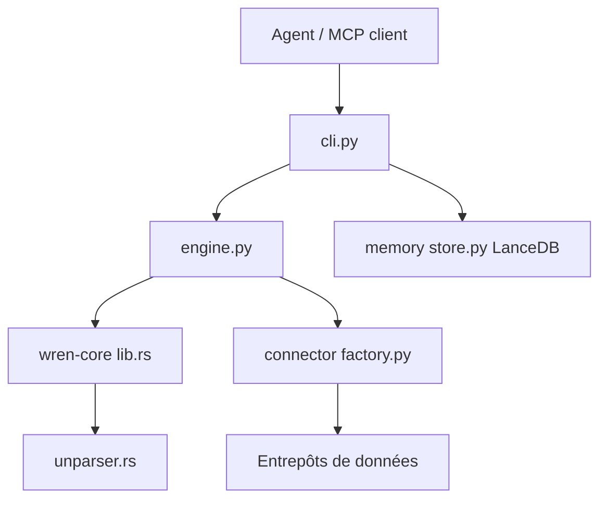

# Canner/WrenAI

> Versioned semantic layer that lets your agents write governed SQL and dashboards.

## The problem
An agent that only sees the schema does not know what "net revenue" means and invents joins. The SQL looks right but is wrong.

## What it actually does
Business definitions (models, metrics, approved joins) are written in MDL, as YAML and Markdown versioned in Git.
A Rust/DataFusion engine turns SQL written on these concepts into SQL adapted to each of the 22+ sources.
The `wren` CLI serves as an MCP server, with skills and a local LanceDB memory.
The generated dashboards deploy to your Vercel or Cloudflare account.

## How it is wired


## Trying it
```bash
pip install wrenai
npx skills add Canner/WrenAI
wren skills get onboarding
wren query --sql '...'
wren ask "<question>" --guided
```

## Cost and gotchas
The LLM comes from your agent and is at your expense. Row- and column-level security, the GenBI interface and the APIs are paid (Wren AI Cloud).

## What it is not
It is not a BI chat interface: the old Docker app is frozen on `legacy/v1`. It is an open core model, and GitHub does not identify the license.

## Alternatives
The README names no competing repository.

## For you
Worth watching: the principle of a semantic layer in Git for agent-driven text-to-SQL concerns you directly, but the recent move to an open core model calls for some distance.
