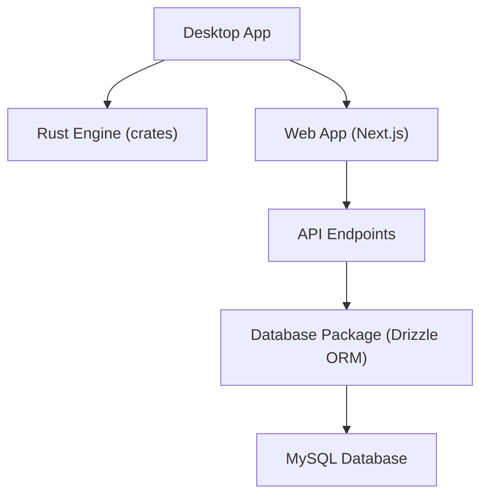

# CapSoftware/Cap

> Open-source screen recorder, a Loom alternative, with share links and optional self-hosting.

## The problem
Sharing a demo or a bug as video often means a closed service where the data stays with the provider.

## What it actually does
Desktop application (macOS, Windows, Linux) with two modes: Instant (upload while recording, immediate link) and Studio (local recording, editing). Web dashboard with comments, transcriptions, viewing analytics and team spaces. Storage possible on an S3-compatible bucket, or full self-hosting with Docker Compose.

## How it is wired


## Trying it
```bash
git clone https://github.com/CapSoftware/Cap.git
cd Cap
docker compose up -d
bun install
bun run env-setup
bun run cap-setup
```

## Cost and gotchas
Cap Cloud is the hosted offering (account required); self-hosting is free but requires Docker, MySQL, MinIO and secrets to be replaced before exposure. Development requires Node.js 24, Bun 1.4.4 and Rust. Tinybird is used for viewing statistics.

## What it is not
Not a data or AI tool. The `analytics:setup` command can delete Tinybird resources outside the configuration: use it only on the right workspace. The license is not identified by GitHub.

## Alternatives
- Loom: the closed service that Cap replaces.

## For you
Ignore: a screen recorder with no direct relation to data, AI or MLOps work, unless you need a self-hosted Loom.
