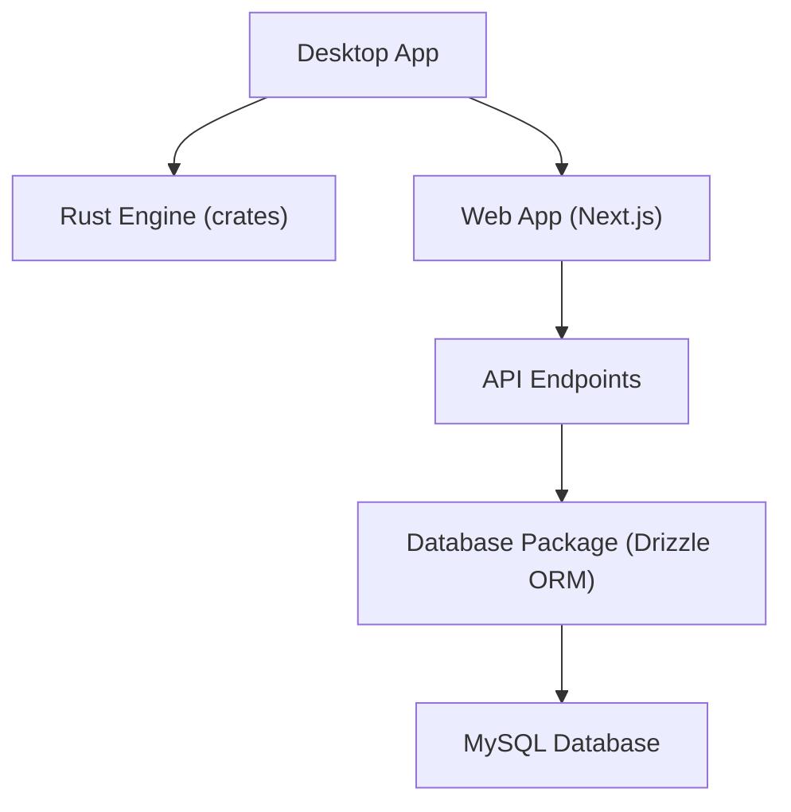

# CapSoftware/Cap

> Enregistreur d'écran libre, alternative à Loom, avec liens de partage et auto-hébergement possible.

## Le problème
Partager une démo ou un bug en vidéo impose souvent un service fermé où les données restent chez le fournisseur.

## Ce que ça fait vraiment
Application de bureau (macOS, Windows, Linux) avec deux modes : Instant (envoi pendant l'enregistrement, lien immédiat) et Studio (enregistrement local, montage). Tableau de bord web avec commentaires, transcriptions, analyses de visionnage et espaces d'équipe. Stockage possible sur un bucket S3 compatible ou auto-hébergement complet avec Docker Compose.

## Comment c'est branché


## Essayer
```bash
git clone https://github.com/CapSoftware/Cap.git
cd Cap
docker compose up -d
bun install
bun run env-setup
bun run cap-setup
```

## Coût et pièges
Cap Cloud est l'offre hébergée (compte à créer) ; l'auto-hébergement est gratuit mais demande Docker, MySQL, MinIO et des secrets à remplacer avant exposition. Le développement exige Node.js 24, Bun 1.4.4 et Rust. Tinybird sert aux statistiques de visionnage.

## Ce que ce n'est pas
Pas un outil de data ou d'IA. La commande `analytics:setup` peut supprimer des ressources Tinybird hors configuration : à n'utiliser que sur le bon espace de travail. La licence n'est pas identifiée par GitHub.

## Alternatives
- Loom : le service fermé que Cap remplace.

## Pour toi
À ignorer : un enregistreur d'écran sans rapport direct avec le travail data, IA ou MLOps, sauf besoin d'un Loom auto-hébergé.

