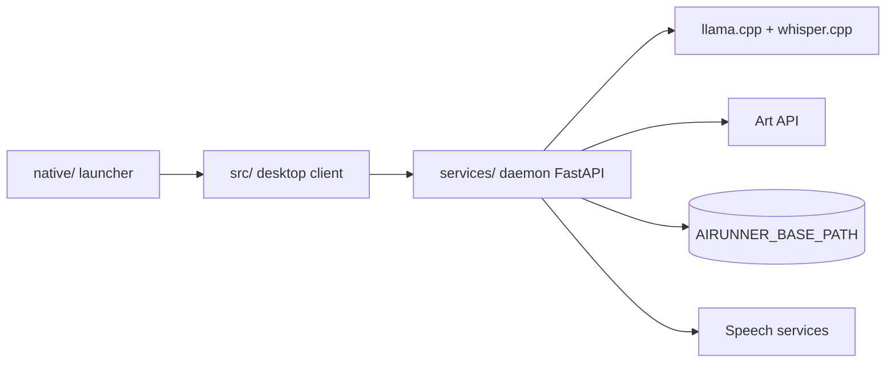

# Capsize-Games/airunner

> Local AI companion and image generation application, with a headless server compatible with OpenAI and Ollama.

## The problem
Using an LLM, voice and image generation locally requires assembling several engines and interfaces yourself.

## What it actually does
A desktop application (Qt) and a headless FastAPI daemon. A named companion with personality, voice (TTS, STT) and RAG memory; a layered canvas with SDXL and Z-Image Turbo. The local LLM (Qwen3.5-9B GGUF by default) goes through a llama.cpp sidecar; OpenRouter, OpenAI and Ollama are possible. The server exposes `/llm`, `/art`, `/tts`, `/stt`, plus Ollama and OpenAI routes.

## How it is wired


## Trying it
```bash
xhost +local:docker && docker compose run --rm airunner
docker compose run --rm --service-ports airunner --headless
airunner-headless --ollama-mode --model "/path/to/your/model"
```

## Cost and gotchas
Free, but 16 GB of RAM minimum, NVIDIA RTX 3060 GPU minimum, 22 to 100 GB of disk, Python 3.13+. Models are downloaded from Hugging Face and CivitAI. Optional features call external services (weather, DuckDuckGo, OpenRouter, OpenAI).

## What it is not
Not a commercially supported product: a single engineer develops it. The content filter is inactive until the distributor has generated its list (empty terms file). Windows is experimental.

## Alternatives
Ollama, whose compatible mode replaces the server for existing clients.

## For you
Worth watching: a unified local LLM and image inference server, interesting for prototyping off the cloud, but demanding on hardware and carried by a single person.
