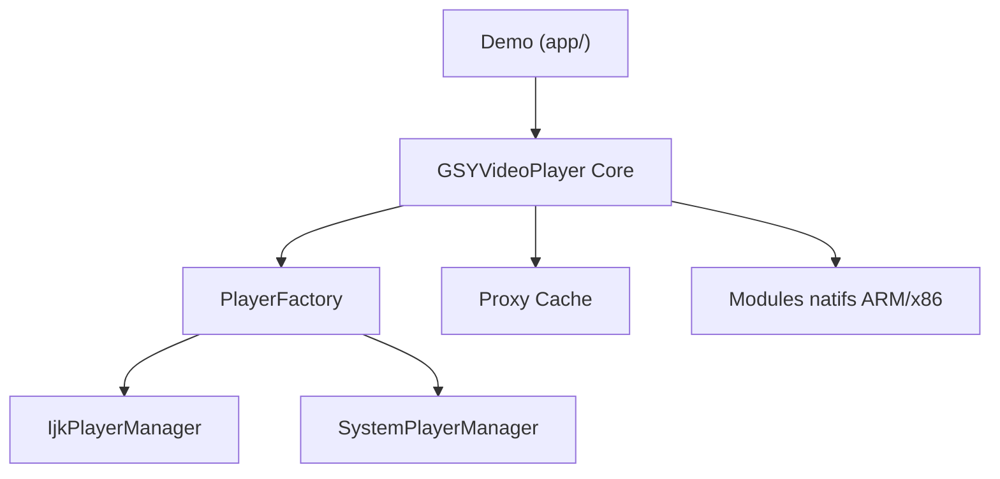

# CarGuo/GSYVideoPlayer

> Multi-engine Android video playback library (IJK, Media3, AliPlayer) with cache, filters and subtitles.

## The problem
Android does not offer a ready-to-use video player with cache, fullscreen, list and filters, whatever the engine.

## What it actually does
A modular player: you choose the engine (IJK, Media3/ExoPlayer, MediaPlayer, AliPlayer), the cache, the rendering layer and the interface. It handles HLS, DASH, RTSP, SRT/WebVTT subtitles, screenshots, GL filters and DLNA casting (optional module). Modules exist per architecture (arm64, armv7a, x86_64).

## How it is wired
Diagram based on the supplied one, reduced.



## Trying it
```bash
export GITHUB_READ_USER=
export GITHUB_READ_TOKEN=
```
Then, in `build.gradle`: `implementation 'io.github.carguo:gsyvideoplayer:14.0.0'` with `mavenCentral()`.

## Cost and gotchas
Free. The README exposes a hard-coded GitHub token as a fallback (likely to be revoked): do not use it. Android API 23 minimum (26 for casting). No technical support, single author.

## What it is not
Not a data or AI tool. No support: "do not provide technical support". The armv5 and x86 modules are legacy and not updated.

## Alternatives
No alternative named in the README (the repo of the former oarplayer player is cited as a complement, without comparison).

## For you
Ignore: Android video player library, outside the data, AI and MLOps scope.
