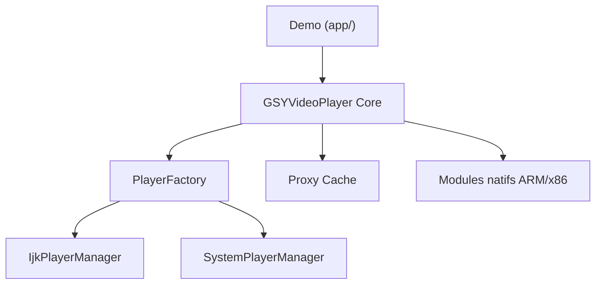

# CarGuo/GSYVideoPlayer

> Bibliothèque Android de lecture vidéo multi-moteurs (IJK, Media3, AliPlayer) avec cache, filtres et sous-titres.

## Le problème
Android n'offre pas un lecteur vidéo prêt à l'emploi avec cache, plein écran, liste et filtres, quel que soit le moteur.

## Ce que ça fait vraiment
Un lecteur modulaire : on choisit le moteur (IJK, Media3/ExoPlayer, MediaPlayer, AliPlayer), le cache, la couche de rendu et l'interface. Il gère HLS, DASH, RTSP, sous-titres SRT/WebVTT, captures, filtres GL et casting DLNA (module optionnel). Des modules existent par architecture (arm64, armv7a, x86_64).

## Comment c'est branché
Schéma d'après le diagramme fourni, réduit.



## Essayer
```bash
export GITHUB_READ_USER=
export GITHUB_READ_TOKEN=
```
Puis, dans `build.gradle` : `implementation 'io.github.carguo:gsyvideoplayer:14.0.0'` avec `mavenCentral()`.

## Coût et pièges
Gratuit. Le README expose un jeton GitHub codé en dur comme secours (susceptible d'être révoqué) : ne pas s'en servir. Android API 23 minimum (26 pour le casting). Pas de support technique, auteur unique.

## Ce que ce n'est pas
Pas un outil data ou IA. Pas de support : « do not provide technical support ». Les modules armv5 et x86 sont historiques et non mis à jour.

## Alternatives
Aucune alternative nommée dans le README (le dépôt de l'ancien lecteur oarplayer est cité comme complément, sans comparaison).

## Pour toi
À ignorer : bibliothèque de lecteur vidéo Android, hors du périmètre data, IA et MLOps.

