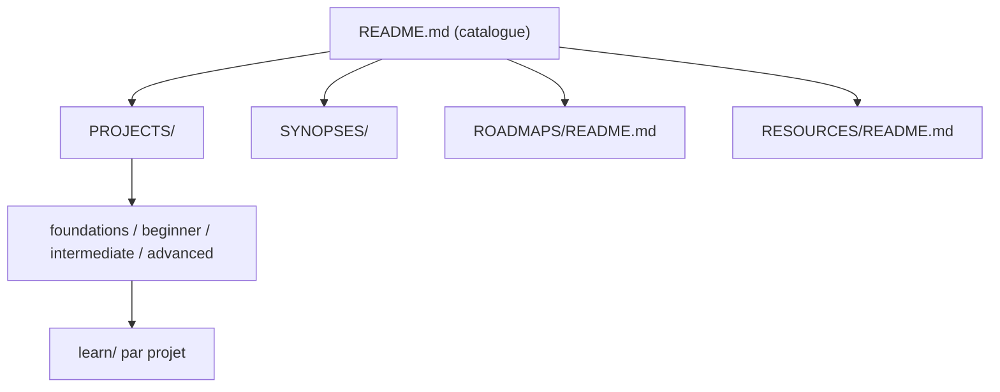

# CarterPerez-dev/Cybersecurity-Projects

> Educational monorepo of cybersecurity projects, sorted into four tiers, with learning paths and resources.

## The problem
Learning security by practice requires realistic, graded examples, scattered across the web.

## What it actually does
- Four tiers: Foundations (heavily commented single-file Python), Beginner, Intermediate, Advanced.
- Each project is self-contained (its own language, dependencies, tests) with a `learn/` folder; others exist only as synopses.
- Areas covered: defense (SIEM, honeypots, ML-based detection, secret scanners), analysis, cryptography, and educational labs on offensive techniques.
- Adds career roadmaps and resources.

## How it is wired

## Trying it
No single command: each project has its own entry point and documentation.

## Cost and gotchas
Free. AGPL-3.0 license: sharing obligations when used as a network service. The README points to the author's CertGames platform.

## What it is not
It is not a single application nor a production-ready tool. The offensive labs are for educational purposes: to be run in an isolated environment, on authorized systems.

## Alternatives
None named in the README.

## For you
Watch: a good mine of references (ML detection, secret scanner, SBOM), to browse for inspiration, not to deploy as is.
