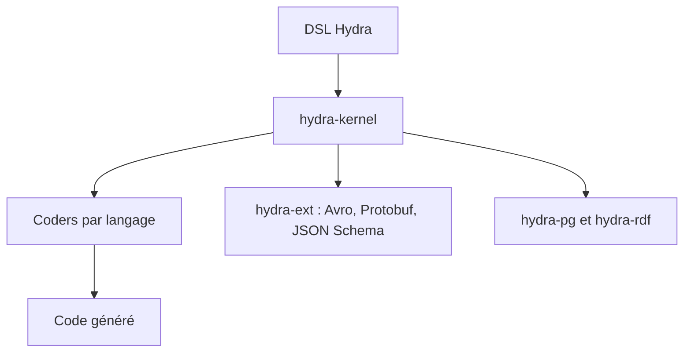

# CategoricalData/hydra

> Typed intermediate language for data, schemas and code, generated to Java, Python, Scala and others.

## The problem
Keeping the same logic or data model across several languages and formats without drift.

## What it actually does
A kernel written once is translated into nine implementations (Haskell, Java, Python, Scala, TypeScript, four Lisps) validated by a test suite. Coders for Protobuf, Avro, JSON Schema, GraphQL, RDF, property graphs. The specification is still a draft.

## How it is wired
Simplified diagram based on the sheet, no diagram provided.


## Trying it
```bash
# Aucune commande exacte dans le README ; paquets sur PyPI, npm, Maven Central, Hackage.
```

## Cost and gotchas
Free. Steep learning curve; 1.0 not yet released; 156 open issues. Go, Rust and C++ targets are in progress.

## What it is not
Not an ORM or a turnkey ETL tool: a modeling and generation language.

## Alternatives
No alternative named in the README.

## For you
Worth watching: relevant for data schemas shared across languages, but heavy to adopt.
