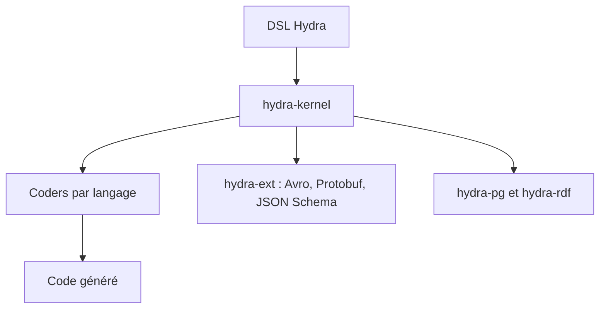

# CategoricalData/hydra

> Langage intermédiaire typé pour données, schémas et code, généré vers Java, Python, Scala et autres.

## Le problème
Garder la même logique ou le même modèle de données dans plusieurs langages et formats sans divergence.

## Ce que ça fait vraiment
Un noyau écrit une fois est traduit vers neuf implémentations (Haskell, Java, Python, Scala, TypeScript, quatre Lisp) validées par une suite de tests. Coders pour Protobuf, Avro, JSON Schema, GraphQL, RDF, graphes de propriétés. Spécification encore en brouillon.

## Comment c'est branché
Schéma simplifié d'après la fiche, sans diagramme fourni.


## Essayer
```bash
# Aucune commande exacte dans le README ; paquets sur PyPI, npm, Maven Central, Hackage.
```

## Coût et pièges
Gratuit. Courbe d'apprentissage forte ; 1.0 pas encore sortie ; 156 issues ouvertes. Les cibles Go, Rust, C++ sont en cours.

## Ce que ce n'est pas
Pas un ORM ni un outil ETL clé en main : un langage de modélisation et de génération.

## Alternatives
Aucune alternative nommée dans le README.

## Pour toi
À surveiller : pertinent pour des schémas de données partagés entre langages, mais lourd à adopter.

