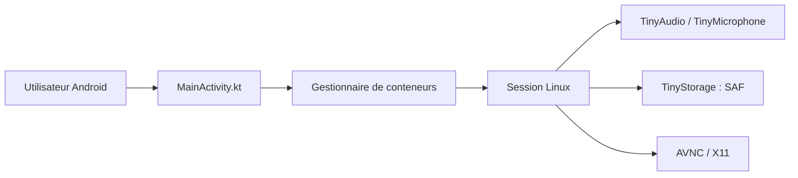

# Cateners/tiny_computer

> Android app that installs and runs Linux containers with a desktop, to use PC software on mobile.

## The problem
Running Linux on Android means going through Termux, its manual installs, and graphics and audio configuration.

## What it actually does
Installs a Debian container in about five minutes, with an Xfce desktop, built-in terminal, AVNC and Termux:X11 included, and audio and microphone passthrough. Offers quick commands for common software, container import/export, launcher shortcuts and file access via SAF. Uses proot. The code is stated to be heavily AI-written.

## How it is wired

## Trying it
No documented command. Install the APK from the releases; to build, drop `jniLibs.zip` into `app/src/main/jniLibs/arm64-v8a` then open in Android Studio.

## Cost and gotchas
Free. arm64 device required; the README says the documentation is not ready. Possible bugs due to AI generation.

## What it is not
No support for chroot, Wayland, Docker, systemd, GNOME, Mali GPU or camera. Not the same codebase as the old Tiny Computer (complete rewrite).

## Alternatives
- Termux: more flexible for developers, cited by the author.
- Kali Nethunter: for an automated installation with root.

## For you
Keep an eye on it: a curiosity for running Linux on a tablet, but too young for data/AI use.
