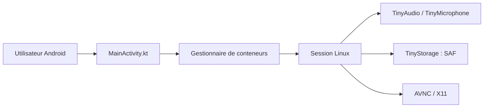

# Cateners/tiny_computer

> App Android qui installe et lance des conteneurs Linux avec bureau, pour utiliser des logiciels PC sur mobile.

## Le problème
Faire tourner Linux sur Android passe par Termux, ses installations manuelles et la configuration graphique et audio.

## Ce que ça fait vraiment
Installe un conteneur Debian en cinq minutes environ, avec bureau Xfce, terminal intégré, AVNC et Termux:X11 inclus, audio et micro transmis. Propose des commandes rapides pour logiciels courants, l'import/export de conteneurs, des raccourcis de lanceur et l'accès aux fichiers via SAF. Utilise proot. Le code est annoncé comme fortement écrit avec de l'IA.

## Comment c'est branché

## Essayer
Aucune commande documentée. Installer l'APK depuis les releases ; pour compiler, déposer `jniLibs.zip` dans `app/src/main/jniLibs/arm64-v8a` puis ouvrir dans Android Studio.

## Coût et pièges
Gratuit. Appareil arm64, README disant que la documentation n'est pas prête. Bugs possibles dus à la génération par IA.

## Ce que ce n'est pas
Pas de support chroot, Wayland, Docker, systemd, GNOME, GPU Mali ni caméra. Pas la même base que l'ancien Tiny Computer (réécriture complète).

## Alternatives
- Termux : plus flexible pour les développeurs, cité par l'auteur.
- Kali Nethunter : pour une installation automatisée avec root.

## Pour toi
À surveiller : curiosité pour lancer du Linux sur tablette, mais trop jeune pour un usage data/IA.

