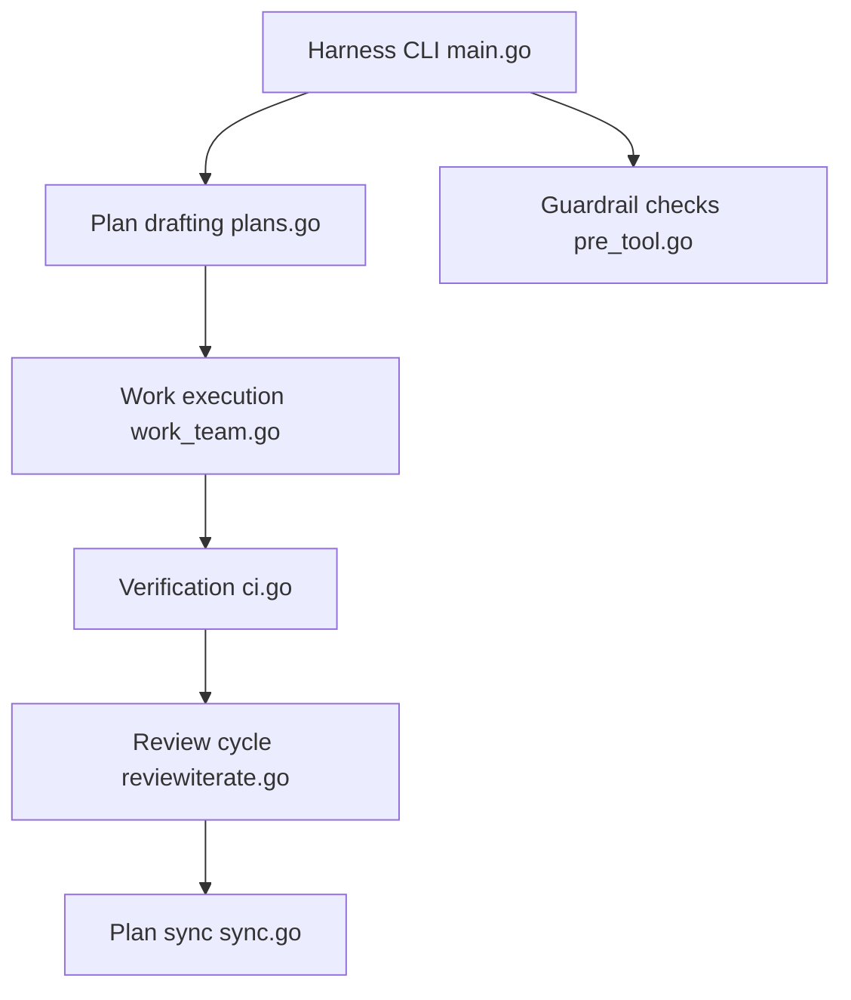

# Chachamaru127/claude-code-harness

> Plan, execute, review workflow plugin for Claude Code, Codex, Cursor or Grok, with guardrails.

## The problem
You have to re-explain the work every session, track progress by hand, and you get an "it works" with no proof and no independent review.

## What it actually does
Five skills: `/harness-plan` (writes `spec.md` and `Plans.md`), `/harness-work`, `/harness-review` (separate reviewer), `/harness-sync`, `/harness-release`. A guardrail engine written in Go checks operations through hooks (secrets, deployment, force push, protected files). Tasks are tracked in `Plans.md`, state lives in `.claude/state/`. `/breezing` and `/harness-loop` for large jobs.

## How it is wired


## Trying it
```text
/plugin marketplace add Chachamaru127/claude-code-harness
/plugin install harness@claude-code-harness-marketplace
/harness-setup
/harness-plan Stop the contact form from sending twice.
/harness-work all
/harness-review
```

## Cost and gotchas
The plugin is free; the assistant and the model are at your expense, and several agents and reviews consume more. The checks do not guarantee they contain every command; Cursor has no filesystem isolation. The Codex `--user` script replaces existing `worker.toml` and `reviewer.toml`.

## What it is not
Not a spending cap or an account. A reviewed change may still require your acceptance before publication.

## Alternatives
No alternative named in the README.

## For you
Worth watching: the spec, plan, independent review discipline transfers to ML projects; start with a small task to measure the overhead.
