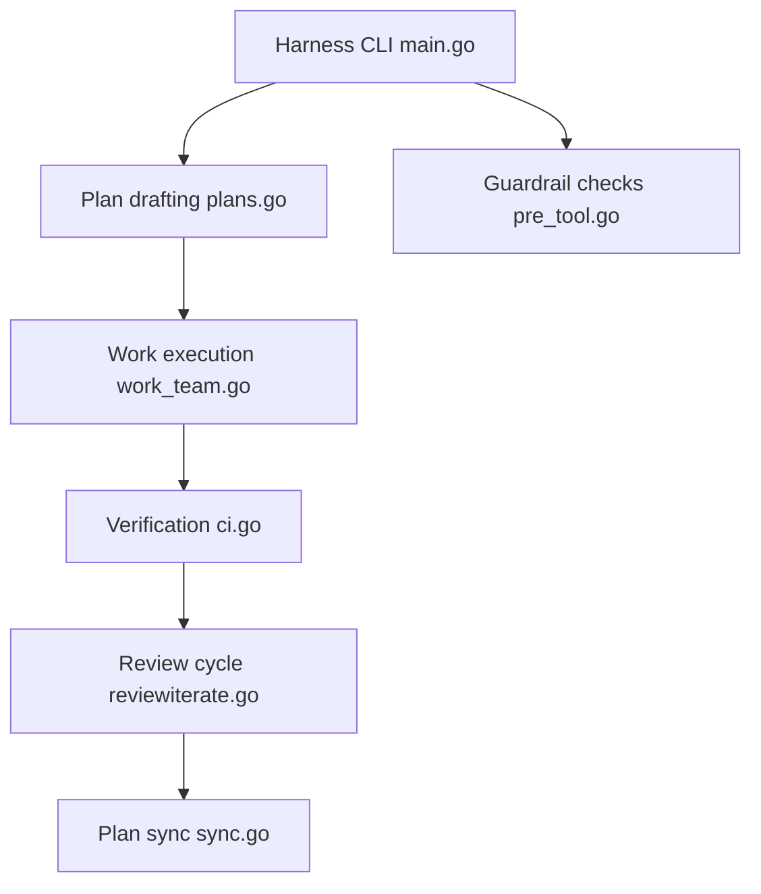

# Chachamaru127/claude-code-harness

> Plugin de workflow planifier, exécuter, relire pour Claude Code, Codex, Cursor ou Grok, avec garde-fous.

## Le problème
On doit réexpliquer le travail à chaque session, suivre l'avancement à la main, et on obtient un « ça marche » sans preuve ni relecture indépendante.

## Ce que ça fait vraiment
Cinq skills : `/harness-plan` (écrit `spec.md` et `Plans.md`), `/harness-work`, `/harness-review` (relecteur séparé), `/harness-sync`, `/harness-release`. Un moteur de garde-fous en Go contrôle les opérations par hooks (secrets, déploiement, push forcé, fichiers protégés). Suivi des tâches dans `Plans.md`, état dans `.claude/state/`. `/breezing` et `/harness-loop` pour les gros chantiers.

## Comment c'est branché


## Essayer
```text
/plugin marketplace add Chachamaru127/claude-code-harness
/plugin install harness@claude-code-harness-marketplace
/harness-setup
/harness-plan Stop the contact form from sending twice.
/harness-work all
/harness-review
```

## Coût et pièges
Le plugin est gratuit ; assistant et modèle sont à ta charge, et plusieurs agents et relectures consomment plus. Les contrôles ne garantissent pas de contenir toute commande ; Cursor n'a pas d'isolation du système de fichiers. Le script Codex `--user` remplace `worker.toml` et `reviewer.toml` existants.

## Ce que ce n'est pas
Pas un plafond de dépenses ni un compte. Un changement relu peut encore exiger ton acceptation avant publication.

## Alternatives
Aucune alternative nommée dans le README.

## Pour toi
À surveiller : la discipline spec, plan, relecture indépendante est transférable à des projets ML ; commence sur une petite tâche pour mesurer le surcoût.

