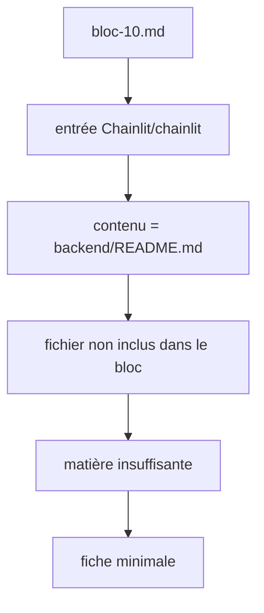

# Chainlit/chainlit

> Undocumented: the block contains no usable README for this repository.

## The problem
Undocumented in the block.
The content provided for this repository is only the string `backend/README.md`, i.e. a pointer to a file absent from the block.

## What it actually does
Undocumented. No description, no feature, no command, no diagram accompanies this repository in the block.
The front matter values above are neutral defaults, not findings: they must not be read as a characterization of the project.
Nothing was completed from another source, in accordance with the "no invention" rule.
The extraction must be rerun on `backend/README.md` to obtain a fiche.

## How it is wired

## Trying it
No documented command.

## Cost and gotchas
Undocumented. No API key, GPU, Docker or quota is mentioned in the block.
The only pitfall identified is upstream: the collection retrieved a file path instead of the README.

## What it is not
It is not a fiche: it is the record of a failed extraction.
It is not a repository judged to be poor — the material was simply not provided.
It is not a reason to conclude anything about the project itself.

## Alternatives
No repository named in the content provided.

## For you
To be redone: without a README, no decision is possible.
