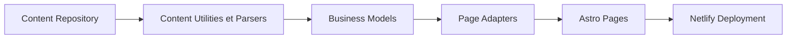

# Chalarangelo/30-seconds-of-code

> Short articles with code snippets for developers, accessible on a static website.

## The problem
Quickly find a reliable code snippet (JavaScript, CSS, HTML, Python, React) without having to read lengthy tutorials.

## What it actually does
The site can be searched by name, tag, language, or description; each card opens an article with an excerpt, explanation, and examples. The repository contains the content (YAML and Markdown), templates, adapters, and serializers, and generates pages, RSS feeds, sitemaps, and search indexes using Astro, which is deployed on Netlify.

## How it is wired

## Trying it
There are no documented commands in the README: the content is available on the website.

## Cost and gotchas
Free. The code content is licensed under CC-BY-4.0, but the text, images, website code, logos, and names cannot be reused without explicit permission from the author: please read this before any reuse. Content contributions are no longer accepted.

## What it is not
This is not a collection of importable utilities. The repository contains the code for a website, rather than a single package.

## Alternatives
No alternative is specified in the README.

## For you
Things to be aware of: front-end focused, static content (no new contributions), and ambiguous reuse clauses.
