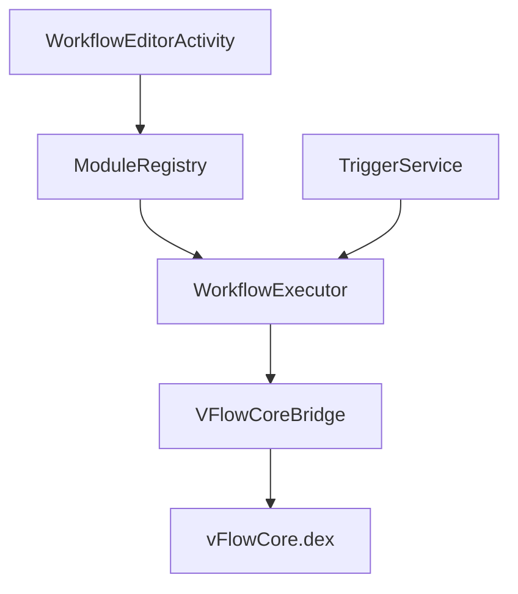

# ChaoMixian/vFlow

> Android app for modular visual automation, for anyone who wants to chain clicks, conditions and system actions.

## The problem
Automating repetitive gestures on an Android phone requires code or closed tools. Here, you assemble blocks.

## What it actually does
A block-based workflow editor (click, text search, if/else, loop) where one module's output feeds the next. The engine runs inside the app; a high-privilege `vFlowCore.dex` backend, started on demand, covers system actions. Triggers are time, notifications, clipboard, location and voice. Workflows can be exported and imported.

## How it is wired
Simplified diagram based on the sheet, no diagram provided.



## Trying it
```bash
git clone https://github.com/ChaoMixian/vflow.git
```
Then open the project in Android Studio, wait for the Gradle sync and run on a device or an emulator.

## Cost and gotchas
No key or bill, but an Android Studio build is required. Some features need Root or Shizuku, and the README warning cites risks of data loss and account bans, at your own expense.

## What it is not
It is not a mature tool: the author acknowledges a feature gap with established software. Documentation is mostly in Chinese. No link with server automation or MLOps.

## Alternatives
No named alternative in the README.

## For you
Ignore: it is a consumer Android tool unrelated to data, AI or MLOps work, and carried by a single maintainer.
