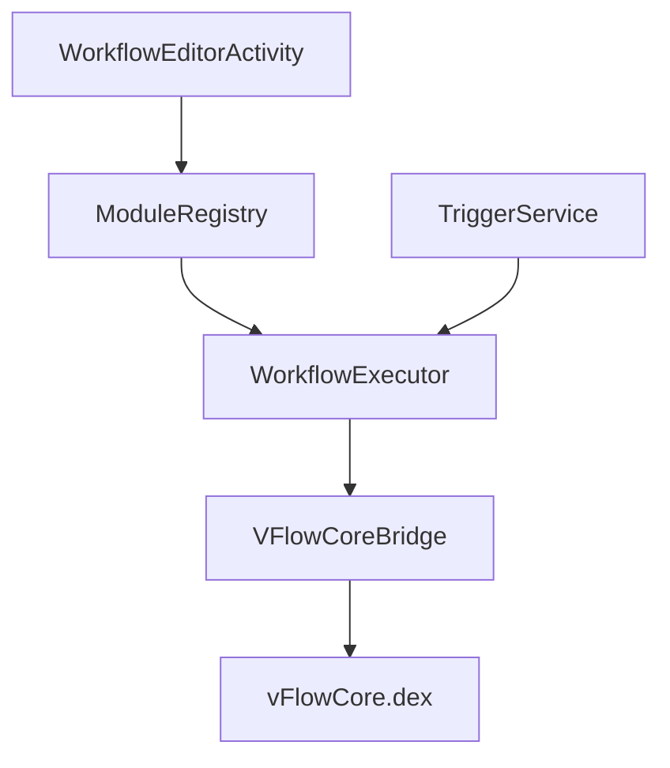

# ChaoMixian/vFlow

> Application Android d'automatisation visuelle par modules, pour qui veut enchaîner clics, conditions et actions système.

## Le problème
Automatiser des gestes répétitifs sur un téléphone Android demande du code ou des outils fermés. Ici, on assemble des blocs.

## Ce que ça fait vraiment
Un éditeur de workflows par blocs (clic, recherche de texte, si/sinon, boucle) où la sortie d'un module sert d'entrée au suivant. Le moteur tourne dans l'appli ; un backend `vFlowCore.dex` à privilèges élevés, lancé à la demande, couvre les actions système. Les déclencheurs sont l'heure, les notifications, le presse-papiers, la position et la voix. Export et import des workflows.

## Comment c'est branché
Schéma simplifié d'après la fiche, sans diagramme fourni.



## Essayer
```bash
git clone https://github.com/ChaoMixian/vflow.git
```
Puis ouvrir le projet dans Android Studio, attendre la synchronisation Gradle et lancer sur un appareil ou un émulateur.

## Coût et pièges
Aucune clé ni facture, mais une compilation Android Studio. Certaines fonctions demandent Root ou Shizuku, et l'avertissement du README cite risques de perte de données et de bannissement de comptes, à vos frais.

## Ce que ce n'est pas
Ce n'est pas un outil mûr : l'auteur reconnaît un écart de fonctionnalités avec les logiciels établis. Documentation surtout en chinois. Aucun lien avec l'automatisation serveur ou MLOps.

## Alternatives
Aucune alternative nommée dans le README.

## Pour toi
À ignorer : c'est un outil Android grand public sans rapport avec un travail data, IA ou MLOps, et porté par un seul mainteneur.

