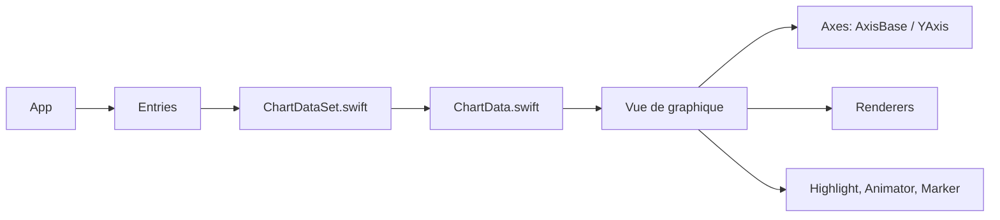

# ChartsOrg/Charts

> Swift charting library (DGCharts) for iOS, tvOS and macOS, for Apple app developers.

## The problem
Draw interactive line, bar or pie charts in an Apple app without writing the rendering yourself.

## What it actually does
A Swift port of MPAndroidChart. Thirteen announced chart families (line, bar, pie, candlestick, bubble, radar, scatter, combined charts), touch zoom and pan, dual and customizable axes, highlighting with popups, PNG/JPEG export, animations, limit lines. Usable from Swift and Objective-C. The project was renamed DGCharts to avoid the conflict with Apple's Swift Charts.

## How it is wired


## Trying it
```bash
# CocoaPods : ajouter dans le Podfile
pod 'DGCharts'
# Carthage
github "ChartsOrg/Charts" ~> 5.1.0
```
The README also documents Swift Package Manager (`.package(url: "https://github.com/ChartsOrg/Charts.git", .upToNextMajor(from: "5.1.0"))`).

## Cost and gotchas
Free. Xcode 14 / Swift 5.7 for the master branch; iOS 12+, tvOS 12+, macOS 10.13+. The README warns that the master branch may not compile with an older Swift compiler. 978 open issues.

## What it is not
Not a data visualization library for Python or the web, and no documentation of its own: the README points to the MPAndroidChart wiki (API "95% identical").

## Alternatives
Apple's Swift Charts (cited in the README as the cause of the rename); no other alternative named.

## For you
Ignore: a rendering tool for native iOS/macOS apps, outside the data/AI/MLOps scope.
