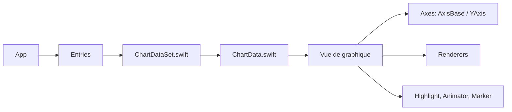

# ChartsOrg/Charts

> Bibliothèque Swift (DGCharts) de graphiques pour iOS, tvOS et macOS, pour développeurs d'applications Apple.

## Le problème
Tracer des courbes, barres ou camemberts interactifs dans une app Apple sans écrire le rendu soi-même.

## Ce que ça fait vraiment
Port Swift de MPAndroidChart. Treize familles de graphiques annoncées (ligne, barres, camembert, bougies, bulles, radar, nuage de points, graphiques combinés), zoom et déplacement au toucher, axes doubles et personnalisables, surbrillance avec popups, export PNG/JPEG, animations, lignes limites. Utilisable depuis Swift et Objective-C. Le projet a été renommé DGCharts pour éviter le conflit avec Swift Charts d'Apple.

## Comment c'est branché


## Essayer
```bash
# CocoaPods : ajouter dans le Podfile
pod 'DGCharts'
# Carthage
github "ChartsOrg/Charts" ~> 5.1.0
```
Le README documente aussi Swift Package Manager (`.package(url: "https://github.com/ChartsOrg/Charts.git", .upToNextMajor(from: "5.1.0"))`).

## Coût et pièges
Gratuit. Xcode 14 / Swift 5.7 pour la branche master ; iOS 12+, tvOS 12+, macOS 10.13+. Le README prévient que la branche master peut ne pas compiler avec un compilateur Swift plus ancien. 978 issues ouvertes.

## Ce que ce n'est pas
Pas une bibliothèque de visualisation de données pour Python ou le web, et pas de documentation propre : le README renvoie au wiki de MPAndroidChart (API « à 95 % identique »).

## Alternatives
Swift Charts d'Apple (cité dans le README comme cause du renommage) ; pas d'autre alternative nommée.

## Pour toi
Ignorer : outil de rendu pour apps iOS/macOS natives, hors du périmètre data/IA/MLOps.

