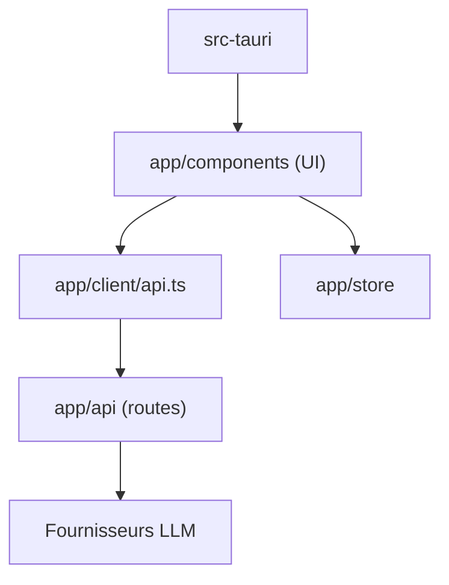

# ChatGPTNextWeb/NextChat

> Lightweight, self-hosted chat interface, compatible with OpenAI, Claude, Gemini, DeepSeek, and local models.

## The problem
Provide a team or oneself with a single chat interface to interact with multiple model providers, without requiring a subscription for each provider.

## What it actually does
Next.js application (web/PWA, Tauri client ~5 MB) that routes to OpenAI, Azure, Anthropic, Google, Baidu, ByteDance, Alibaba, DeepSeek, and other services via `app/api` endpoints. Features: prompts (masks), plugins, artifacts, real-time chat, optional MCP (Microsoft Copilot Pro), history compression, data stored in the browser, and UpStash synchronization.

## How it is wired


## Trying it
```bash
docker pull yidadaa/chatgpt-next-web
docker run -d -p 3000:3000 \
   -e OPENAI_API_KEY=sk-xxxx \
   -e CODE=your-password \
   yidadaa/chatgpt-next-web
```

## Cost and gotchas
API key provided by the vendor. Limited access control: the `CODE` variable; MCP requires `CODE`. The README mentions a paid enterprise edition and a paid SaaS version, as well as an iOS app whose source code is "coming soon".

## What it is not
Not a template or inference engine. Access control is a simple password, not user management. The last update was on 2026-10-20, with 862 open issues.

## Alternatives
No alternative is specified in the README (RWKV-Runner and LocalAI are mentioned for local models).

## For you
Things to watch out for: It's a quick way to display a chat UI to multiple models, but the basic access control limits its use in a team setting.
