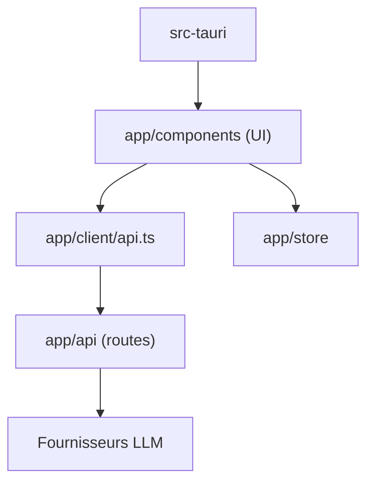

# ChatGPTNextWeb/NextChat

> Interface de chat légère auto-hébergeable, compatible OpenAI, Claude, Gemini, DeepSeek et modèles locaux.

## Le problème
Offrir à une équipe ou à soi-même une interface de chat unique devant plusieurs fournisseurs de modèles, sans abonnement par outil.

## Ce que ça fait vraiment
Appli Next.js (client web/PWA, client Tauri ~5 Mo) qui route par des endpoints `app/api` vers OpenAI, Azure, Anthropic, Google, Baidu, ByteDance, Alibaba, DeepSeek et autres. Fonctions : masques (prompts), plugins, artefacts, chat temps réel, MCP optionnel, compression d'historique, données stockées dans le navigateur, synchro UpStash.

## Comment c'est branché


## Essayer
```bash
docker pull yidadaa/chatgpt-next-web
docker run -d -p 3000:3000 \
   -e OPENAI_API_KEY=sk-xxxx \
   -e CODE=your-password \
   yidadaa/chatgpt-next-web
```

## Coût et pièges
Clé d'API du fournisseur à ta charge. Contrôle d'accès limité : variable `CODE` ; MCP exige `CODE`. Le README mentionne une édition entreprise et une version SaaS payantes, ainsi qu'une app iOS dont le code source est « à venir ».

## Ce que ce n'est pas
Pas un modèle ni un moteur d'inférence. Le contrôle d'accès est un simple mot de passe, pas une gestion d'utilisateurs. Dernier push le 2026-10-20 avec 862 issues ouvertes.

## Alternatives
Aucune alternative nommée dans le README (cite RWKV-Runner et LocalAI pour les modèles locaux).

## Pour toi
À surveiller : pratique pour exposer vite une UI de chat à plusieurs modèles, mais le contrôle d'accès rudimentaire limite l'usage en équipe.

