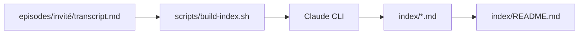

# ChatPRD/lennys-podcast-transcripts

> Archive of 269 transcripts of Lenny's podcast, in Markdown, ready for AI assistants and RAG.

## The problem
Making use of hundreds of hours of product podcasts requires clean, structured transcripts.

## What it actually does
One folder per guest with `transcript.md` and a YAML header (title, date, duration, YouTube URL). An index of more than 50 themes, generated with the Claude CLI, helps navigation. The `build-index.sh` script regenerates it. The README lists many projects built on top of it (RAG, MCP, graphs).

## How it is wired


## Trying it
```bash
grep -r "product-market fit" episodes/
./scripts/build-index.sh
```

## Cost and gotchas
Free to read; regenerating the index consumes Claude CLI usage. Last push on 2026-01-28, no news since.

## What it is not
Not an open license: none is declared, and the README states the content belongs to the podcast and its guests, for educational and research use.

## Alternatives
No alternative named in the README, but it lists derived projects (Lenny MCP, Lennyhub RAG).

## For you
Worth watching: a handy corpus for testing a RAG, but unclear rights, so reserve it for internal experimentation.
