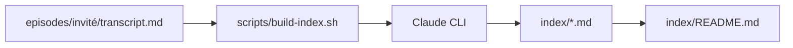

# ChatPRD/lennys-podcast-transcripts

> Archive de 269 transcriptions du podcast de Lenny, en Markdown, prête pour assistants IA et RAG.

## Le problème
Exploiter des centaines d'heures de podcast produit demande des transcriptions propres et structurées.

## Ce que ça fait vraiment
Un dossier par invité avec `transcript.md` et un en-tête YAML (titre, date, durée, URL YouTube). Un index de plus de 50 thèmes, généré avec le CLI Claude, aide à naviguer. Le script `build-index.sh` le régénère. Le README liste de nombreux projets bâtis dessus (RAG, MCP, graphes).

## Comment c'est branché


## Essayer
```bash
grep -r "product-market fit" episodes/
./scripts/build-index.sh
```

## Coût et pièges
Gratuit pour lire ; régénérer l'index consomme du Claude CLI. Dernier push le 2026-01-28, sans nouvelles depuis.

## Ce que ce n'est pas
Pas une licence ouverte : aucune n'est déclarée, et le README indique que le contenu appartient au podcast et à ses invités, pour usage éducatif et recherche.

## Alternatives
Aucune alternative nommée dans le README, mais il liste des projets dérivés (Lenny MCP, Lennyhub RAG).

## Pour toi
À surveiller : corpus pratique pour tester un RAG, mais droits flous, donc à réserver à l'expérimentation interne.

