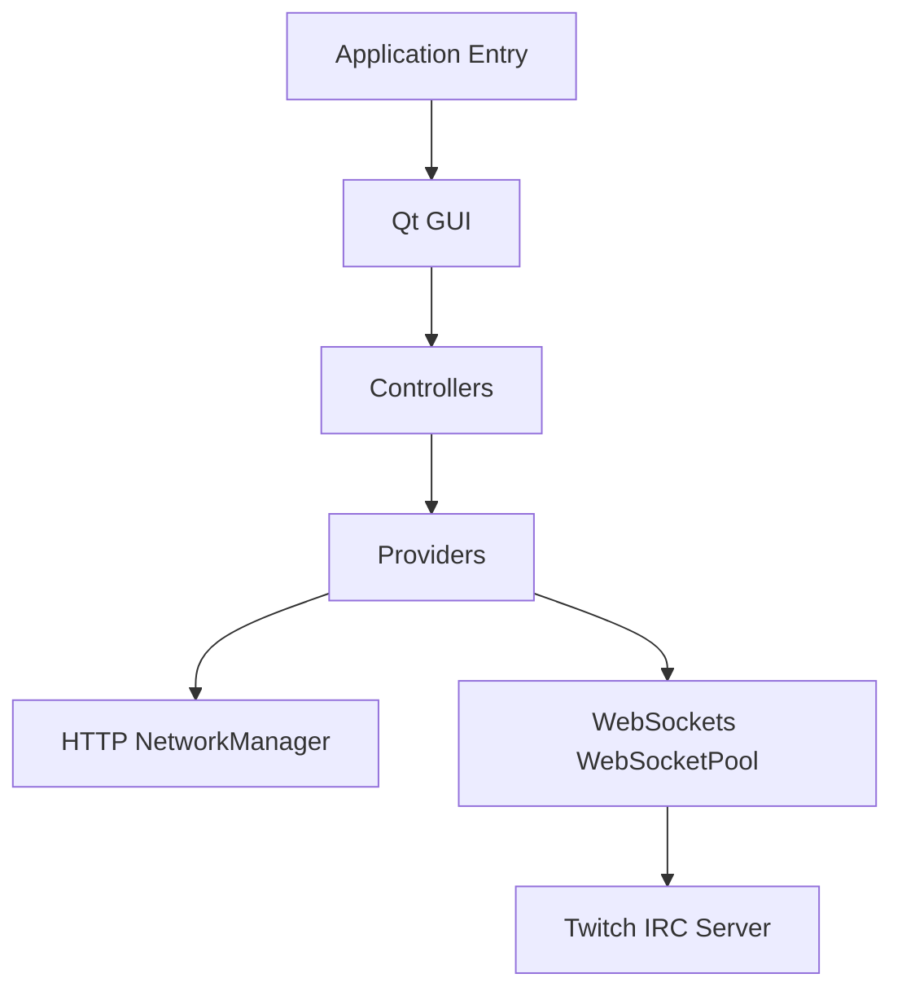

# Chatterino/chatterino2

> Desktop chat client for Twitch.tv, in C++ with Qt.

## The problem
Twitch's web chat is heavy for following several channels and customizing filters and highlights.

## What it actually does
Qt application that connects to Twitch's IRC, to the Helix and PubSub/EventSub APIs and to third-party emote services, applies filters and highlights, and displays a rich chat. Architecture based on singletons, controllers, models, providers, HTTP and WebSocket networking. Lua plugins.

## How it is wired


## Trying it
```shell
git clone --recurse-submodules https://github.com/Chatterino/chatterino2.git
```
Ready-to-use releases are at https://chatterino.com; Chocolatey on Windows.

## Cost and gotchas
Free. A Twitch account is needed to write in the chat. Building requires Qt and CMake.

## What it is not
Not a moderation or data analysis tool. Not a client for another platform.

## Alternatives
No alternative named in the README.

## For you
Ignore: a Twitch chat client, with no link to data / AI / MLOps work.
