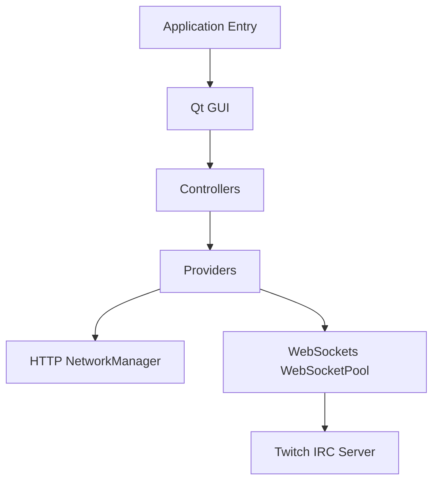

# Chatterino/chatterino2

> Client de chat de bureau pour Twitch.tv, en C++ avec Qt.

## Le problème
Le chat web de Twitch est lourd pour suivre plusieurs chaînes et personnaliser filtres et surbrillances.

## Ce que ça fait vraiment
Application Qt qui se connecte à l'IRC de Twitch, aux API Helix et PubSub/EventSub et à des services d'émotes tiers, applique filtres et surbrillances, et affiche un chat riche. Architecture en singletons, contrôleurs, modèles, fournisseurs, réseau HTTP et WebSocket. Plugins Lua.

## Comment c'est branché


## Essayer
```shell
git clone --recurse-submodules https://github.com/Chatterino/chatterino2.git
```
Les versions prêtes à l'emploi sont sur https://chatterino.com ; Chocolatey sous Windows.

## Coût et pièges
Gratuit. Un compte Twitch est nécessaire pour écrire dans le chat. Compilation avec Qt et CMake.

## Ce que ce n'est pas
Pas un outil de modération ni d'analyse de données. Pas un client pour une autre plateforme.

## Alternatives
Aucune alternative nommée dans le README.

## Pour toi
Ignorer : un client de chat Twitch, sans lien avec un travail data / IA / MLOps.

