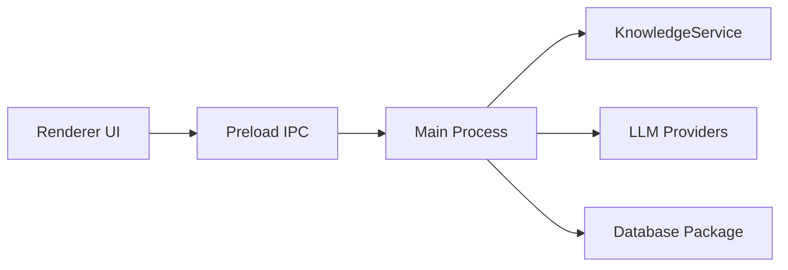

# CherryHQ/cherry-studio

> AI-powered office workspace: multi-modal chat, agents, knowledge bases, and image generation.

## The problem
Managing multiple LLM providers, document bases, and tools requires managing numerous separate interfaces.

## What it actually does
Application Electron for Windows, macOS, and Linux. Connects to OpenAI, Anthropic, Gemini, or local models (Ollama, LM Studio). Agents with skills and MCP servers, local knowledge bases, OCR, translation, web search, API gateway, and WebDAV backup. A paid Enterprise edition is available.

## How it is wired

## Trying it
No documented command: download the application from the download page (links not reproduced in the README).

## Cost and gotchas
The software is free; you are responsible for obtaining API keys and templates. Several functions require system dependencies or permissions. Enterprise Edition is available on request. Themes v1 must be adapted for v2.

## What it is not
This is not a hosted service. The AGPL-3.0 requires that the source code be shared if a modified version is made available over a network.

## Alternatives
No alternative is mentioned in the README (new-api and one-api are cited as related projects, as LLM gateways).

## For you
Things to watch out for: A practical office-based solution for comparing models and building a local knowledge base, with 2,118 open issues indicating a very demanding project.
