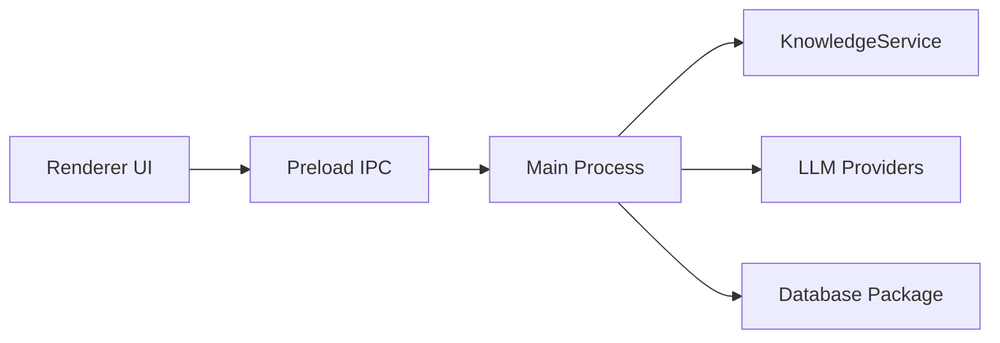

# CherryHQ/cherry-studio

> Poste de travail IA de bureau : chat multi-modèles, agents, bases de connaissances et génération d'images.

## Le problème
Jongler entre plusieurs fournisseurs de LLM, bases de documents et outils demande autant d'interfaces séparées.

## Ce que ça fait vraiment
Application Electron pour Windows, macOS et Linux. Se connecte à OpenAI, Anthropic, Gemini ou à des modèles locaux (Ollama, LM Studio). Agents avec Skills et serveurs MCP, bases de connaissances locales, OCR, traduction, recherche web, passerelle d'API, sauvegarde WebDAV. Une édition Entreprise payante existe.

## Comment c'est branché

## Essayer
Aucune commande documentée : télécharger l'application depuis la page de téléchargement (liens non reproduits dans le README).

## Coût et pièges
Gratuit côté logiciel ; clés d'API et modèles à ta charge. Plusieurs fonctions exigent des dépendances ou permissions système. Édition Entreprise sur devis. Les thèmes v1 doivent être adaptés à la v2.

## Ce que ce n'est pas
Pas un service hébergé. L'AGPL-3.0 impose le partage des sources en cas d'exposition réseau d'une version modifiée.

## Alternatives
Aucune alternative nommée dans le README (new-api et one-api sont cités comme projets liés, des passerelles LLM).

## Pour toi
À surveiller : client de bureau pratique pour comparer des modèles et monter une base de connaissances locale, avec 2 118 issues ouvertes qui signalent un projet très chargé.

