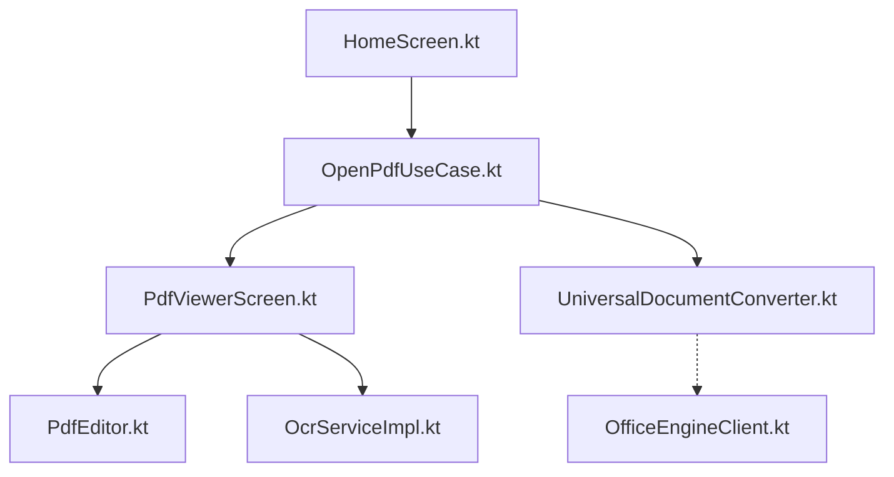

# Chethan616/ClearPDF

> Free Android application to read, annotate, sign and create PDFs and open Office documents.

## The problem
Mobile PDF tools are often closed, paid, or send files online.

## What it actually does
Reading, annotations, forms, page merge/split, encryption, local OCR, scanning (ML Kit), image editor, XLSX editor. Word and PowerPoint open read-only and export to PDF. An optional LibreOffice engine downloads on demand. Local processing; network only for that engine and for converting a web address.

## How it is wired


## Trying it
```bash
git clone https://github.com/Chethan616/ClearPDF.git
cd ClearPDF
./gradlew :app:assembleFossDebug
```

## Cost and gotchas
Android 6.0+ (7.0+ on Google Play). Scanning and background removal may go through Google Play services. A release build without a local key is signed with the debug key.

## What it is not
Does not rewrite the existing text of a PDF nor the Word/PowerPoint layout.

## Alternatives
No alternative named in the README.

## For you
Ignore: a consumer phone application, outside your data / AI pipeline, even though local OCR can help out.
