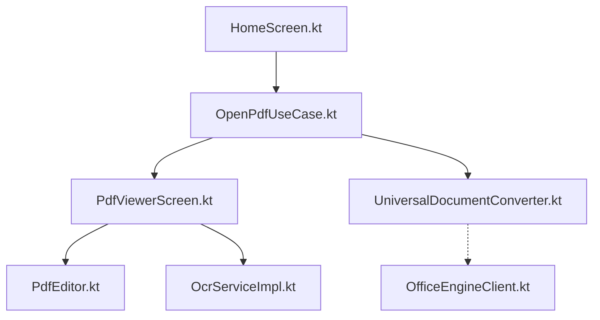

# Chethan616/ClearPDF

> Application Android libre pour lire, annoter, signer et créer des PDF et ouvrir des documents Office.

## Le problème
Les outils PDF mobiles sont souvent fermés, payants ou envoient les fichiers en ligne.

## Ce que ça fait vraiment
Lecture, annotations, formulaires, fusion/découpe de pages, chiffrement, OCR local, scan (ML Kit), éditeur d'images, éditeur XLSX. Word et PowerPoint s'ouvrent en lecture et s'exportent en PDF. Un moteur LibreOffice optionnel se télécharge à la demande. Traitement local ; réseau seulement pour ce moteur et la conversion d'une adresse web.

## Comment c'est branché


## Essayer
```bash
git clone https://github.com/Chethan616/ClearPDF.git
cd ClearPDF
./gradlew :app:assembleFossDebug
```

## Coût et pièges
Android 6.0+ (7.0+ sur Google Play). Scan et suppression d'arrière-plan peuvent passer par les services Google Play. Un build de release sans clé locale est signé avec la clé de debug.

## Ce que ce n'est pas
Ne réécrit pas le texte existant d'un PDF ni la mise en page Word/PowerPoint.

## Alternatives
Aucune alternative nommée dans le README.

## Pour toi
Ignorer : application grand public sur téléphone, hors de ton pipeline data / IA, même si l'OCR local peut dépanner.

