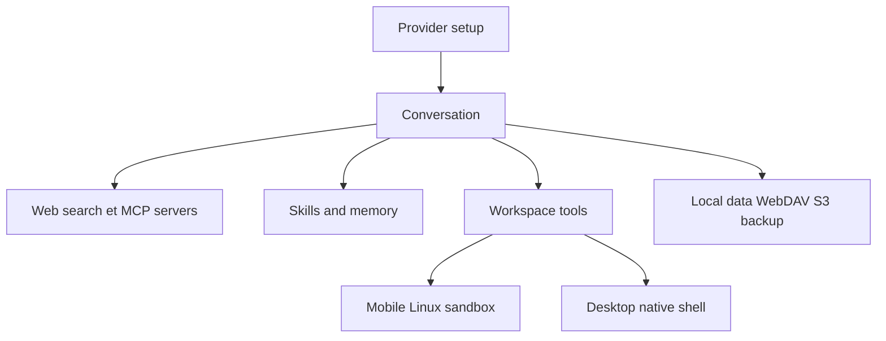

# Chevey339/kelivo

> Free LLM client for mobile and desktop, with workspaces, MCP and memory, no account of its own.

## The problem
Using several model providers means juggling between applications, often tied to an account and without access to local files.

## What it actually does
A Flutter application (Android, iOS, macOS, Windows, Linux). You add your own keys (OpenAI, Gemini, Claude, DeepSeek, OpenRouter, compatible endpoints). Features: web search (24 services), MCP servers, skills, long-term memory, world books, scheduled tasks, and "workspaces" giving the model seven tools (shell, file read/write, grep) in a Linux sandbox on mobile or the native shell on desktop. Local data, WebDAV/S3 backup.

## How it is wired


## Trying it
```bash
git clone https://github.com/Chevey339/kelivo.git
cd kelivo
flutter pub get
flutter run
```

## Cost and gotchas
AGPL-3.0 license: obligation to publish modifications offered over a network. On desktop, workspace commands are not isolated; keep approval enabled. 550 open issues.

## What it is not
Not a model host: you need your own keys. No Kelivo account, hence no in-house synchronization.

## Alternatives
- Cherry Studio and Chatbox: similar clients whose data Kelivo can import (cited in the README).

## For you
Worth watching if you want a local multi-model client with file access; take the AGPL into account if you embed it.
