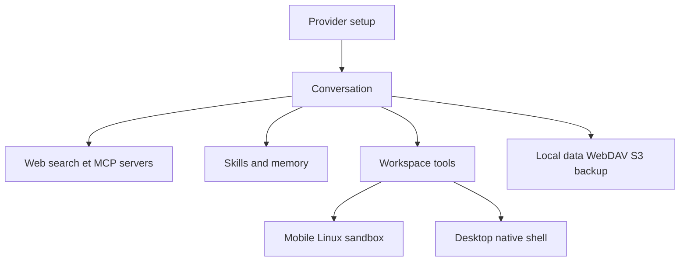

# Chevey339/kelivo

> Client LLM libre pour mobile et bureau, avec espaces de travail, MCP et mémoire, sans compte propre.

## Le problème
Utiliser plusieurs fournisseurs de modèles oblige à jongler entre des applications, souvent liées à un compte et sans accès aux fichiers locaux.

## Ce que ça fait vraiment
Application Flutter (Android, iOS, macOS, Windows, Linux). Tu ajoutes tes clés (OpenAI, Gemini, Claude, DeepSeek, OpenRouter, endpoints compatibles). Fonctions : recherche web (24 services), serveurs MCP, skills, mémoire à long terme, livres du monde, tâches planifiées, et « workspaces » donnant au modèle sept outils (shell, lecture/écriture de fichiers, grep) dans un bac Linux sur mobile ou le shell natif sur bureau. Données locales, sauvegarde WebDAV/S3.

## Comment c'est branché


## Essayer
```bash
git clone https://github.com/Chevey339/kelivo.git
cd kelivo
flutter pub get
flutter run
```

## Coût et pièges
Licence AGPL-3.0 : obligation de publier les modifications offertes en réseau. Sur bureau, les commandes de l'espace de travail ne sont pas isolées ; garde l'approbation activée. 550 issues ouvertes.

## Ce que ce n'est pas
Pas un hébergeur de modèles : il faut tes clés. Pas de compte Kelivo, donc pas de synchronisation maison.

## Alternatives
- Cherry Studio et Chatbox : clients similaires dont Kelivo sait importer les données (cités dans le README).

## Pour toi
À surveiller si tu veux un client multi-modèles local avec accès fichiers ; AGPL à prendre en compte si tu l'embarques.

