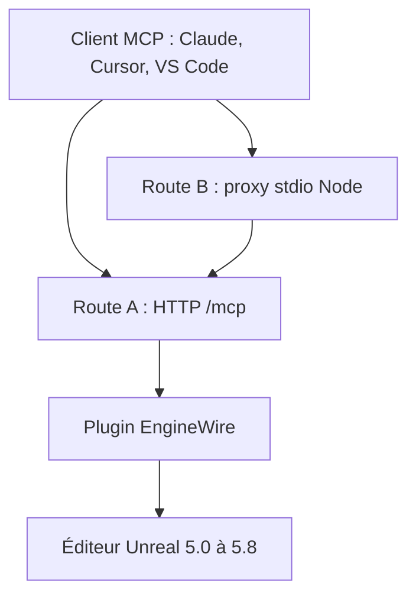

# ChiR24/Unreal_mcp

> Unreal Engine editor plugin that exposes an MCP server to drive the editor from an AI assistant.

## The problem
Building levels, Blueprints and materials by hand in Unreal is slow; an AI assistant has no direct access to the editor.

## What it actually does
A C++ plugin (EngineWire) runs inside the editor and serves MCP over HTTP on port 3000. A single `unreal` tool offers four operations: `search`, `describe`, `execute`, `configure`, behind which sit more than 450 capabilities. Deletions require explicit consent. A token protects access, local-only by default.

## How it is wired
Simplified diagram based on the sheet, no diagram provided.


## Trying it
```bash
claude mcp add --transport http unreal-engine http://127.0.0.1:3000/mcp --header "X-MCP-Capability-Token: <token>"
npx unreal-engine-mcp-server@beta doctor
```

## Cost and gotchas
An installed Unreal editor (5.0 to 5.8) is required and, to build the plugin, a C++ project. The token in `Saved/MCP/capability-token` should be treated like a password.

## What it is not
It is not a model nor an assistant: you need an MCP client alongside. Version 0.5.x exposed 23 tools, 0.6 exposes one.

## Alternatives
No alternative named in the README.

## For you
Worth watching: interesting as an example of a single-tool MCP gateway that saves context, but only useful if you work with Unreal.
