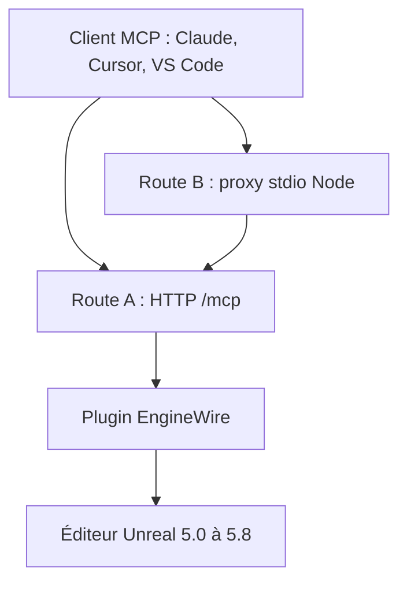

# ChiR24/Unreal_mcp

> Plugin d'éditeur Unreal Engine qui expose un serveur MCP pour piloter l'éditeur depuis un assistant IA.

## Le problème
Construire niveaux, Blueprints et matériaux à la main dans Unreal est long ; un assistant IA n'a pas d'accès direct à l'éditeur.

## Ce que ça fait vraiment
Un plugin C++ (EngineWire) tourne dans l'éditeur et sert MCP en HTTP sur le port 3000. Un seul outil `unreal` offre quatre opérations : `search`, `describe`, `execute`, `configure`, derrière lesquelles se trouvent plus de 450 capacités. Les suppressions demandent un consentement explicite. Un jeton protège l'accès, en local par défaut.

## Comment c'est branché
Schéma simplifié d'après la fiche, sans diagramme fourni.


## Essayer
```bash
claude mcp add --transport http unreal-engine http://127.0.0.1:3000/mcp --header "X-MCP-Capability-Token: <token>"
npx unreal-engine-mcp-server@beta doctor
```

## Coût et pièges
Il faut un éditeur Unreal installé (5.0 à 5.8) et, pour compiler le plugin, un projet C++. Le jeton dans `Saved/MCP/capability-token` se traite comme un mot de passe.

## Ce que ce n'est pas
Ce n'est pas un modèle ni un assistant : il faut un client MCP à côté. La version 0.5.x exposait 23 outils, la 0.6 un seul.

## Alternatives
Aucune alternative nommée dans le README.

## Pour toi
À surveiller : intéressant comme exemple de passerelle MCP à un seul outil qui économise le contexte, mais utile seulement si tu touches à Unreal.

