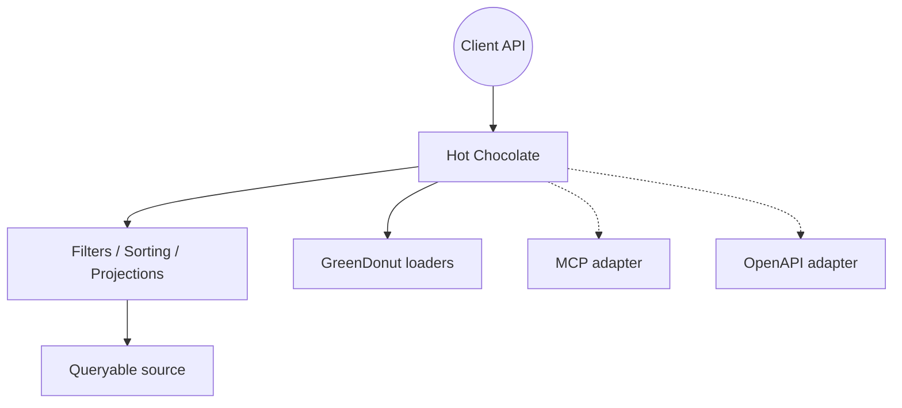

# ChilliCream/graphql-platform

> .NET suite for building GraphQL servers, clients and tools: Hot Chocolate, Nitro, Strawberry Shake.

## The problem
Exposing and consuming GraphQL APIs in .NET requires a typed server, a client and a data loader that avoids the N+1 problem.

## What it actually does
Hot Chocolate is a GraphQL server with filtering, sorting, projections and pagination over queryable sources. Green Donut provides DataLoader (batching, caching). Nitro is a GraphQL IDE. Strawberry Shake is a typed client. MCP and OpenAPI adapters.

## How it is wired

## Trying it
No documented command: the README points to each product's documentation.

## Cost and gotchas
Free. Requires the .NET ecosystem (outside the standard prerequisites list). 423 open issues.

## What it is not
Not a tool for Python or ML models. Not an inference server.

## Alternatives
No alternative named in the README.

## For you
Ignore: .NET platform, unless your data stack exposes GraphQL APIs in C#.
