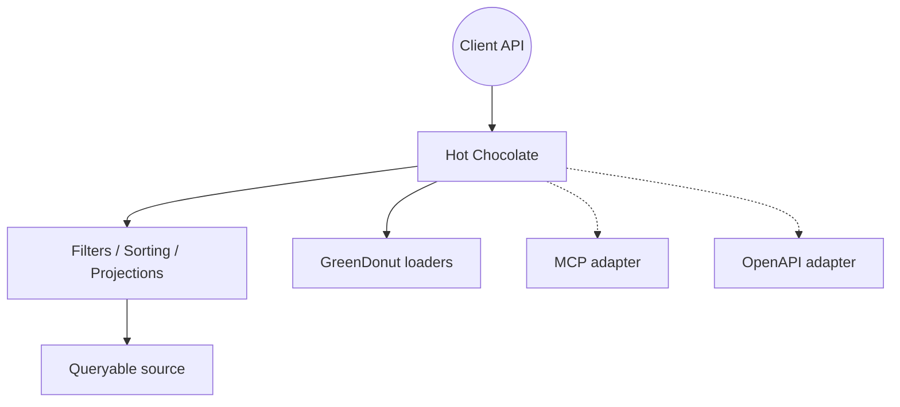

# ChilliCream/graphql-platform

> Suite .NET pour construire serveurs, clients et outils GraphQL : Hot Chocolate, Nitro, Strawberry Shake.

## Le problème
Exposer et consommer des API GraphQL en .NET demande un serveur typé, un client et un chargeur de données évitant le problème N+1.

## Ce que ça fait vraiment
Hot Chocolate est un serveur GraphQL avec filtres, tri, projections et pagination sur des sources interrogeables. Green Donut apporte DataLoader (batching, cache). Nitro est un IDE GraphQL. Strawberry Shake est un client typé. Adaptateurs MCP et OpenAPI.

## Comment c'est branché

## Essayer
Aucune commande documentée : le README renvoie vers la documentation de chaque produit.

## Coût et pièges
Gratuit. Écosystème .NET requis (hors liste de prérequis standard). 423 issues ouvertes.

## Ce que ce n'est pas
Pas un outil pour Python ni pour des modèles ML. Pas un serveur d'inférence.

## Alternatives
Aucune alternative nommée dans le README.

## Pour toi
Ignorer : plateforme .NET, sauf si ta pile data expose des API GraphQL en C#.

