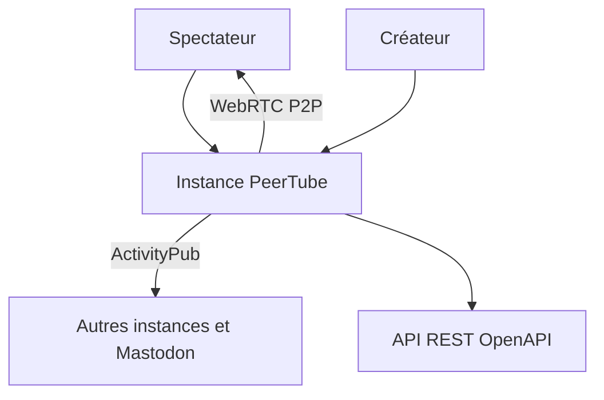

# Chocobozzz/PeerTube

> Federated, self-hosted video platform, an alternative to YouTube, for those who want to host their own videos.

## The problem
Video platforms centralize data and attention. Hosting your own videos is expensive in bandwidth.

## What it actually does
A video server that federates with other instances via ActivityPub (Mastodon, etc.). Streaming and live, subscription through the fediverse or RSS, peer-to-peer load sharing via WebRTC, cache between friendly instances, customizable interface, REST API (OpenAPI 3.0.0). Developed by Framasoft.

## How it is wired
Simplified diagram based on the sheet, no diagram provided.

## Trying it
No command documented in the README: follow the production guide and the community packages (YunoHost, Docker) cited.

## Cost and gotchas
Free, but you need a server whose size depends on the audience (see the project FAQ). Hosting, storage and moderation are on you. AGPL license: modified code exposed over a network must be published.

## What it is not
It is not a turnkey service: you administer your instance. It is not a video analysis or recommendation tool.

## Alternatives
No alternative named in the README (YouTube, Dailymotion and Vimeo are cited as the centralized platforms targeted).

## For you
Ignore: federated video hosting unrelated to models or pipelines, unless you want to publish your own video demos.
