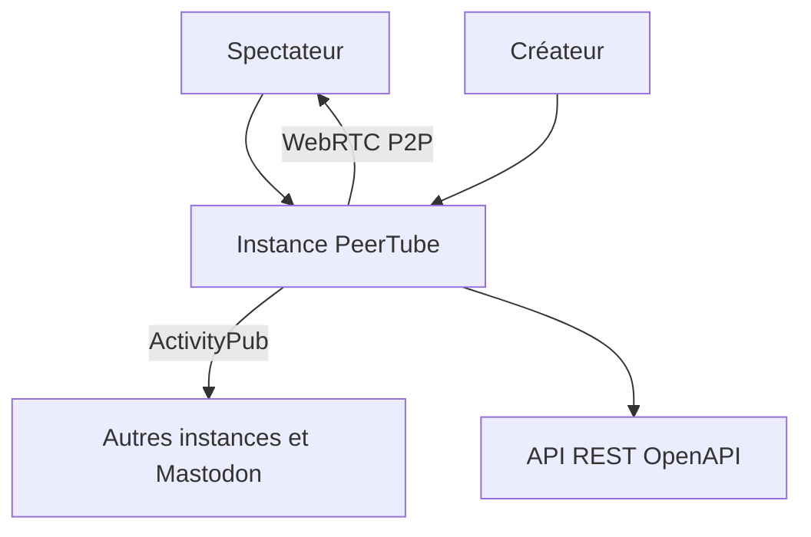

# Chocobozzz/PeerTube

> Plateforme vidéo fédérée et auto-hébergée, alternative à YouTube, pour qui veut héberger ses vidéos.

## Le problème
Les plateformes vidéo centralisent les données et l'attention. Héberger soi-même ses vidéos coûte cher en bande passante.

## Ce que ça fait vraiment
Serveur de vidéo qui se fédère avec d'autres instances via ActivityPub (Mastodon, etc.). Streaming et direct, abonnement par le fediverse ou RSS, partage de charge en pair-à-pair via WebRTC, cache entre instances amies, interface personnalisable, API REST (OpenAPI 3.0.0). Développé par Framasoft.

## Comment c'est branché
Schéma simplifié d'après la fiche, sans diagramme fourni.

## Essayer
Aucune commande documentée dans le README : suivre le guide de production et les paquets communautaires (YunoHost, Docker) cités.

## Coût et pièges
Gratuit, mais il faut un serveur dont la taille dépend de l'audience (voir la FAQ du projet). Hébergement, stockage et modération à ta charge. Licence AGPL : le code modifié et exposé en réseau doit être publié.

## Ce que ce n'est pas
Ce n'est pas un service clé en main : tu administres ton instance. Ce n'est pas un outil d'analyse ou de recommandation vidéo.

## Alternatives
Aucune alternative nommée dans le README (YouTube, Dailymotion et Vimeo sont cités comme plateformes centralisées visées).

## Pour toi
À ignorer : hébergement vidéo fédéré sans lien avec les modèles ou les pipelines, sauf si tu veux publier toi-même des démos vidéo.

