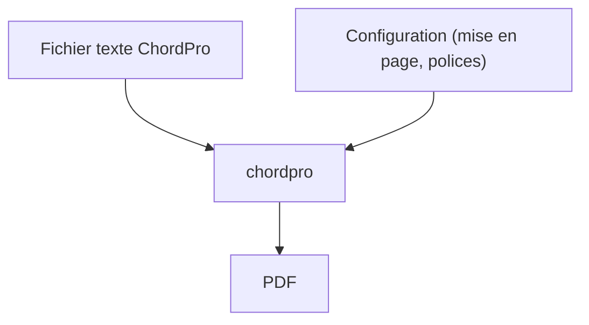

# ChordPro/chordpro

> Program that generates PDF lead sheets of lyrics and chords from text files.

## The problem
Laying out the lyrics and chords of many songs by hand is time-consuming.

## What it actually does
Turns a text file (ChordPro 6 language) into a PDF with advanced markup, annotations, embedded ABC, Unicode and customizable layout. Successor to Chord and Chordii.

## How it is wired
Simplified diagram based on the sheet, no diagram provided.


## Trying it
```bash
chordpro --help
```

## Cost and gotchas
Free. Installation is deferred to the project's website, not detailed here. The license is not identified by GitHub.

## What it is not
Not an editor: it is a command-line typesetting tool.

## Alternatives
- Chord and Chordii (predecessors, of which it is the successor).

## For you
Ignore: music domain, unrelated to your data / AI uses.
