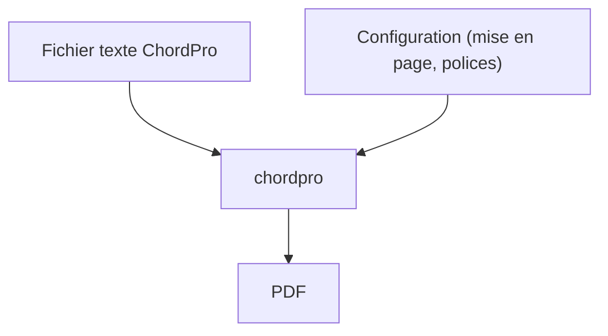

# ChordPro/chordpro

> Programme qui génère des partitions PDF de paroles et d'accords à partir de fichiers texte.

## Le problème
Mettre en page paroles et accords de nombreuses chansons à la main est long.

## Ce que ça fait vraiment
Transforme un fichier texte (langage ChordPro 6) en PDF avec balisage avancé, annotations, ABC intégré, Unicode et mise en page personnalisable. Successeur de Chord et Chordii.

## Comment c'est branché
Schéma simplifié d'après la fiche, sans diagramme fourni.


## Essayer
```bash
chordpro --help
```

## Coût et pièges
Gratuit. L'installation est renvoyée au site du projet, non détaillée ici. La licence n'est pas identifiée par GitHub.

## Ce que ce n'est pas
Pas un éditeur : c'est un outil de composition en ligne de commande.

## Alternatives
- Chord et Chordii (prédécesseurs dont il est le successeur).

## Pour toi
À ignorer : domaine musical, sans lien avec tes usages data / IA.

