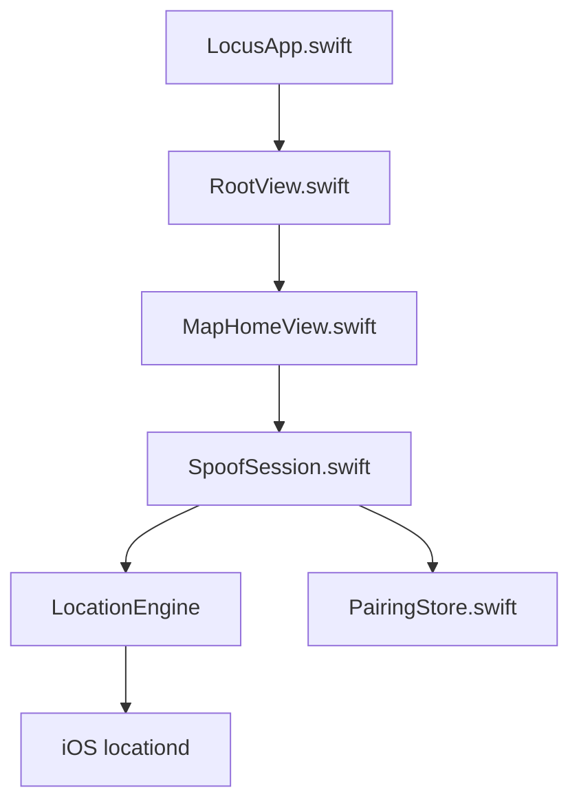

# ChrisMack32/Locus

> iPhone app that simulates the system GPS position through Apple's developer service.

## The problem
Changing an iPhone's location to test or navigate elsewhere requires a Mac and Xcode.

## What it actually does
It injects coordinates into `locationd` through Apple's DVT location simulation, over a local developer tunnel (LocalDevVPN). Teleportation by map or search, joystick, MapKit routes, tracks and GPX, favorites. Pairing on the device (iOS 27) or via an RPPairing file (iOS 18 to 26). No tracking, everything stays on the device.

## How it is wired


## Trying it
```bash
xcodegen generate
open Locus.xcodeproj
```

## Cost and gotchas
Free. It requires developer mode, the LocalDevVPN app and sideloading; building requires an Apple Developer account (even a free one). First and last push on 2026-07-27.

## What it is not
It is not a workaround for Pokémon GO, which rejects this method, according to the README.

## Alternatives
No alternative named as a repository (the README cites iPogo and SpooferPro, modified game clients).

## For you
Ignore: location spoofing on iPhone, unrelated to data / AI, and a very recent repository.
