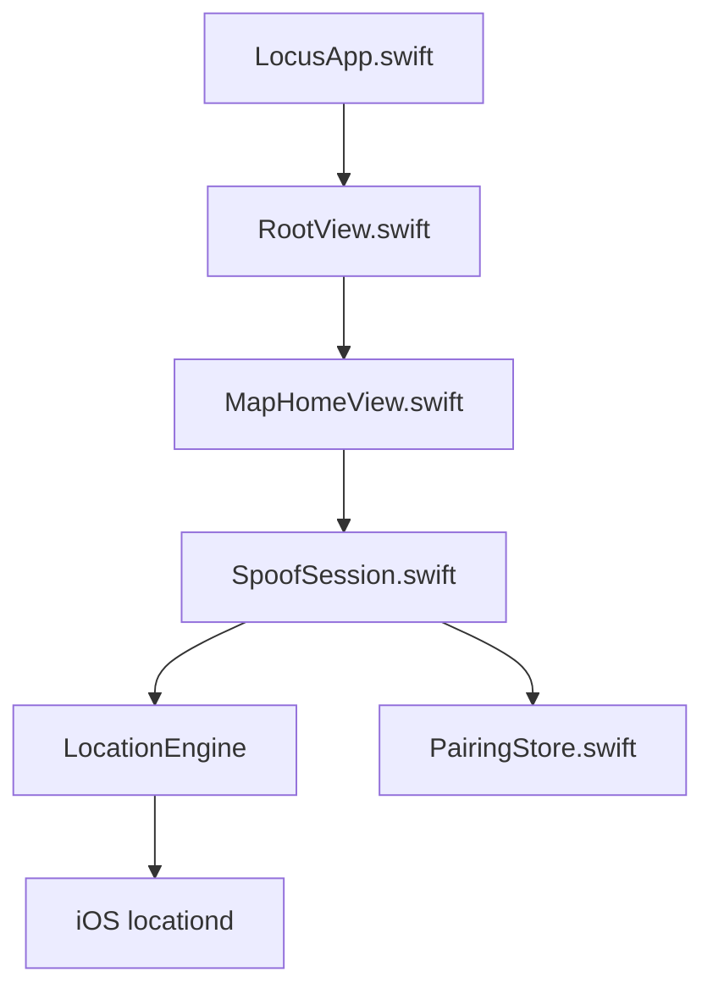

# ChrisMack32/Locus

> Application iPhone qui simule la position GPS système via le service développeur d'Apple.

## Le problème
Changer la position d'un iPhone pour tester ou naviguer ailleurs demande un Mac et Xcode.

## Ce que ça fait vraiment
Injecte des coordonnées dans `locationd` via la simulation de position DVT d'Apple, sur un tunnel développeur local (LocalDevVPN). Téléportation par carte ou recherche, joystick, itinéraires MapKit, tracés et GPX, favoris. Appairage sur l'appareil (iOS 27) ou via un fichier RPPairing (iOS 18 à 26). Aucun suivi, tout reste sur l'appareil.

## Comment c'est branché


## Essayer
```bash
xcodegen generate
open Locus.xcodeproj
```

## Coût et pièges
Gratuit. Il faut le mode développeur, l'app LocalDevVPN et un chargement latéral ; compiler exige un compte Apple Developer (même gratuit). Premier et dernier push le 2026-07-27.

## Ce que ce n'est pas
Ce n'est pas un contournement pour Pokémon GO, qui refuse cette méthode, d'après le README.

## Alternatives
Aucune alternative nommée sous forme de dépôt (le README cite iPogo et SpooferPro, des clients de jeu modifiés).

## Pour toi
À ignorer : falsification de position sur iPhone, sans lien avec data / IA, et dépôt très récent.

