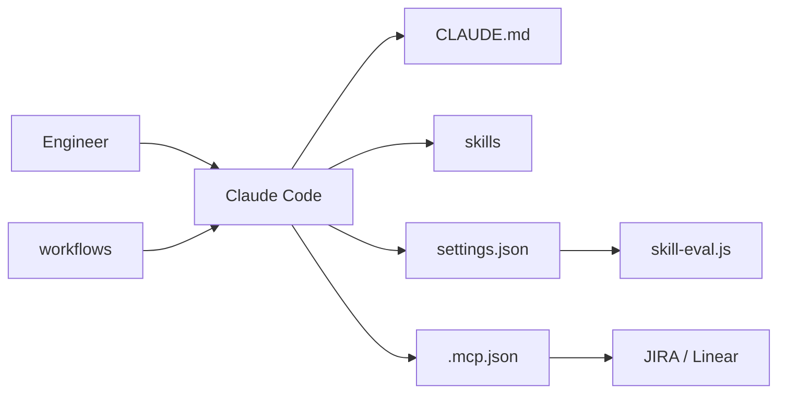

# ChrisWiles/claude-code-showcase

> Complete example of a `.claude/` configuration: skills, agents, hooks, commands and GitHub workflows.

## The problem
The Claude Code docs describe each building block in isolation; there is no project showing how everything fits together in a team.

## What it actually does
Provides a `CLAUDE.md`, a `settings.json` with hooks (blocking on main, formatting, tests), skills (tests, GraphQL, forms).
A `UserPromptSubmit` hook that scores the prompt (keywords, paths, intent) to suggest skills.
Agents (code review), commands (`/ticket` for JIRA/Linear via MCP).
GitHub workflows: PR review, monthly docs sync, dependency audit.

## How it is wired


## Trying it
```bash
mkdir -p .claude/{agents,commands,hooks,skills}
cp -r .claude/hooks/ your-project/.claude/hooks/
```

## Cost and gotchas
Scheduled workflows are billed to your Anthropic key: README estimate of $10 to $50/month.

## What it is not
Not an installable tool: a template to copy and adapt. No license, so reuse is legally unclear; some cited MCP package names need to be verified.

## Alternatives
No alternative named in the README.

## For you
Worth watching as a source of ideas (the skill suggestion hook is worth reusing), but without a license you should take inspiration rather than copy.
