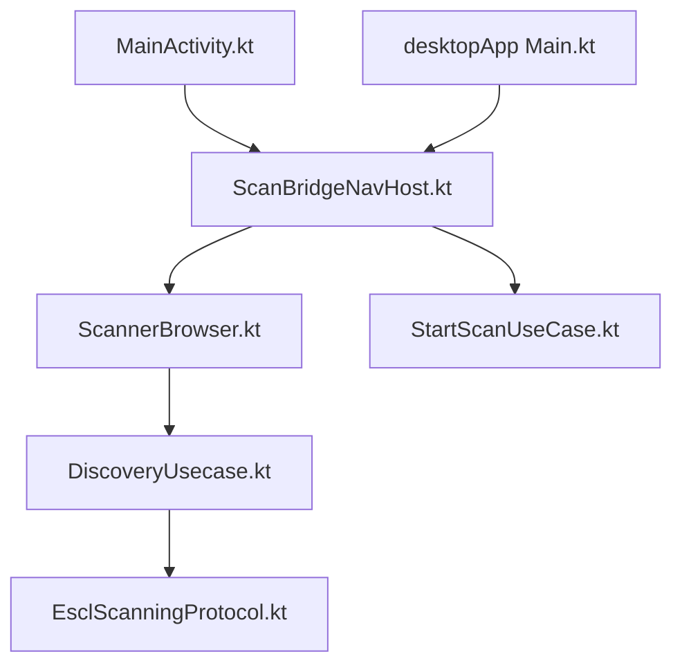

# Chrisimx/ScanBridge

> Material You Android app that scans through eSCL/AirScan-compatible network scanners.

## The problem
Using a network scanner from a phone without a manufacturer driver.

## What it actually does
Discovers eSCL scanners on the network, drives scanning (source, resolution, duplex, dimensions), assembles several pages and exports to PDF or images. Multiplatform Kotlin app (Android and desktop): the Compose interface shares a core (discovery, eSCL protocol, Room database).

## How it is wired


## Trying it
```bash
./gradlew assembleRelease
./gradlew build
```

## Cost and gotchas
Only the internet permission is requested. Available on F-Droid and Google Play (a purchase that supports development). GPL-3.0 license.

## What it is not
Not OCR or document management software: it only scans.

## Alternatives
No alternative named in the README.

## For you
Watch: handy for scanning from a phone, but unrelated to data/AI/MLOps work.
