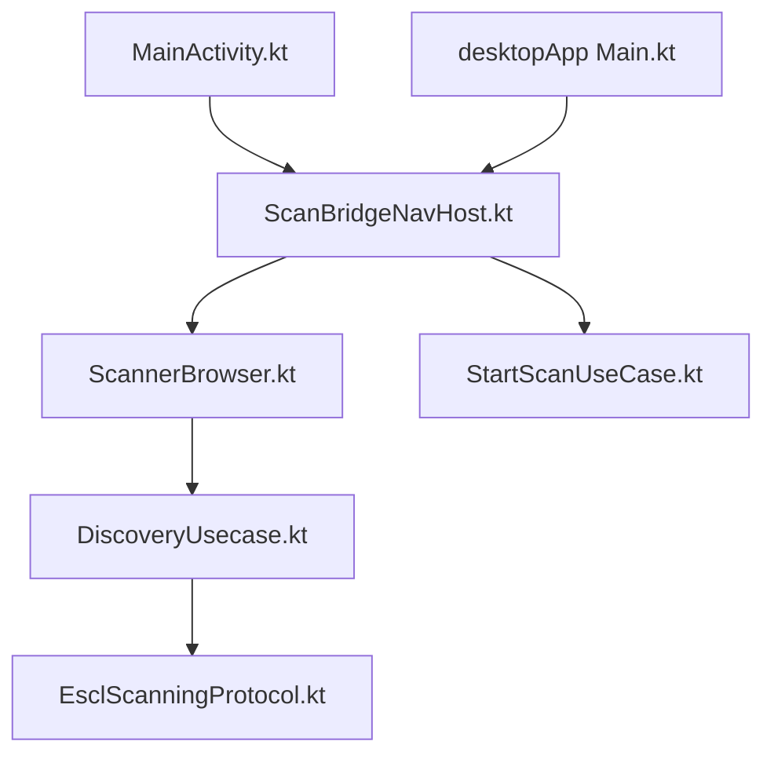

# Chrisimx/ScanBridge

> Application Android Material You qui numérise via les scanners réseau compatibles eSCL/AirScan.

## Le problème
Utiliser un scanner réseau depuis un téléphone sans pilote constructeur.

## Ce que ça fait vraiment
Découvre les scanners eSCL du réseau, pilote la numérisation (source, résolution, recto-verso, dimensions), assemble plusieurs pages et exporte en PDF ou images. Application Kotlin multiplateforme (Android et bureau) : l'interface Compose partage un noyau (découverte, protocole eSCL, base Room).

## Comment c'est branché


## Essayer
```bash
./gradlew assembleRelease
./gradlew build
```

## Coût et pièges
Seule la permission internet est demandée. Disponible sur F-Droid et Google Play (achat qui soutient le développement). Licence GPL-3.0.

## Ce que ce n'est pas
Pas un logiciel d'OCR ni de gestion documentaire : il numérise seulement.

## Alternatives
Aucune alternative nommée dans le README.

## Pour toi
Surveiller : pratique pour numériser depuis un téléphone, mais sans lien avec un travail data/IA/MLOps.

