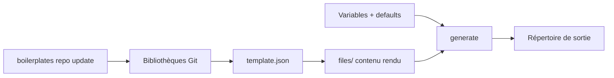

# ChristianLempa/boilerplates

> CLI that turns infrastructure templates (Docker, Terraform, Ansible) into configured files.

## The problem
Homelab configs get copied from one project to the next, with the same variables to change by hand, and nobody knows anymore which version is authoritative.

## What it actually does
Manages Git-backed template libraries, local or remote. Each template declares its variables in a `template.json` and its content under `files/`, with a Jinja2-like syntax but custom delimiters. The CLI lists, inspects, validates and generates, in guided interactive mode or with `--var` on the command line. Recurring values can be frozen as per-type defaults.

## How it is wired


## Trying it
```bash
curl -fsSL https://raw.githubusercontent.com/christianlempa/boilerplates/main/scripts/install.sh | bash
boilerplates repo update
boilerplates compose list
boilerplates compose generate authentik
boilerplates compose generate traefik --output my-proxy --var service_name=traefik --no-interactive
nix run github:christianlempa/boilerplates -- --help
```

## Cost and gotchas
Free, installed via `pipx` by the script. Clean break in `0.2.0`: `template.yaml`/`.yml` manifests and `.j2` files are no longer supported at all. Validation of the `python` and `bash` kinds is deliberately minimal — no compilation, no testing.

## What it is not
It is not an orchestrator: it generates files, it deploys nothing. It is not the template library itself — the 100+ presets live in `boilerplates-library`.

## Alternatives
- **boilerplates-library**: the companion repository, if you only want the presets without the CLI.

## For you
Homelab comfort; little interest if your infra is already under versioned Terraform.
